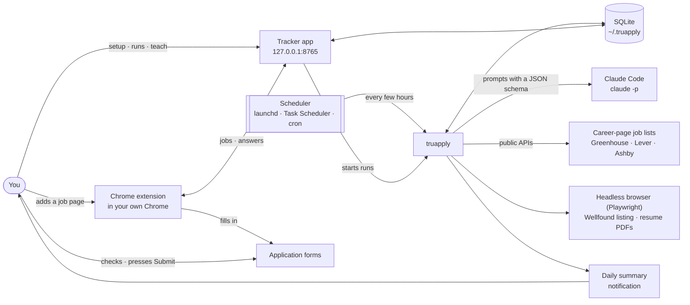

# TruApply docs

*Tru* is for "true". TruApply never lies for you.

TruApply is an open-source job-application assistant that runs on your own computer. It finds jobs that fit you, tailors your resume to each one using only true facts, and fills in applications in your own Chrome through its Chrome extension. You check each form and press Submit. It learns from your answers, edits, dismissals and ratings. It never reads your email. Auto-submit is off until you turn it on in Settings. It uses **Claude Code** (installed on your machine, with your own login) as its AI. Nothing runs on a server we host.

Runs check company career pages (Greenhouse, Lever, Ashby) and the Wellfound listing, unless you turn it off. Jobs on LinkedIn, Naukri, Indeed or any other site come in only when you add the page with the extension. TruApply never signs in to any site for you.

## Read in this order

| Doc | What's in it |
|---|---|
| [plan.md](plan.md) | Goal, target numbers, scope, and the build phases, each with must-pass tests |
| [architecture.md](architecture.md) | How it's built: modules, data, diagrams, the AI calls, the form answers, the resume checks |
| [outcomes.md](outcomes.md) | Learning from your input, and the daily summary |
| [setup-questions.md](setup-questions.md) | Every question a new user is asked, and the defaults |
| [safety.md](safety.md) | No made-up experience, questions never guessed, auto-submit limits, untrusted job pages, account risk, privacy |
| [risks.md](risks.md) | The what-if list: everything that can go wrong and what the tool does about it |
| [examples.md](examples.md) | Real samples: profile, AI prompt and reply, form answers, resume changes, tracker, summary, logs |
| [CONTRIBUTING.md](CONTRIBUTING.md) | Coding rules, dev setup, tests, how to add a job site or a company, how to report a broken site |
| [extension.md](extension.md) | The Chrome extension that fills forms in your own Chrome |
| [other-devices.md](other-devices.md) | Opening the tracker from your phone or another computer, privately, with Tailscale |

## Words used in these docs

| Word | Meaning |
|---|---|
| **ATS** | Applicant tracking system: the software companies use to post jobs and collect applications (Greenhouse, Lever, Ashby, Workday …) |
| **Career pages** | Jobs posted directly on a company's ATS board. No login is needed to read or apply. |
| **Board** | One company's job list on an ATS, e.g. `greenhouse/acme` |
| **Tracker app** | The local page at `127.0.0.1:8765` (`truapply tracker`). Setup, runs, jobs, settings and what it learned all live here. |
| **Setup** | Five steps in the tracker app: your resume, your details, rights and pay, how it runs, and the extension. The other pages stay locked until it's done. |
| **Run** | One pass that finds new jobs, scores them and tailors your resume for the good ones. Start it with **Run now**, or let it run on its own every few hours. |
| **Status** | Where a job is: `new` (found, not scored yet), `skipped` (not a fit, or outside your titles, places or age), `scored`, `ready` (resume ready, waiting for you to apply), `dismissed`, `applied` or `closed`. |
| **Today** | The tracker's home page: what a run did, and the jobs that are scored, ready and applied. |
| **Jobs** and **All jobs** | Every job it found, as cards and as a table you can search, filter and sort. |
| **Activity** | Every run, its log and what went wrong. |
| **Learned** | Your rules, tailoring notes, saved answers and suggested title words to skip. |
| **Chrome extension** | Fills in the application form in your own Chrome and attaches your resume. It leaves legal questions, consent boxes and anything it doesn't know for you, and never presses Submit unless auto-submit is on. |
| **Auto-submit** | A setting, off until you turn it on. The extension then sends ready career-page jobs scoring at or above your chosen score (80 by default), only when nothing on the form is left for you. Two 👎 in the last 10 it sent turn it off. |
| **Rule** | A sentence in plain words on **Learned**, like "no staffing agencies". Rules change scoring, never your facts. |
| **Tailoring note** | A sentence on **Learned** that changes how your resume is tailored, like "keep my summary short". |
| **Master resume** | Your original resume. It's the only source of facts. |
| **Must-pass test** | A check a build phase has to pass before the next phase starts |
