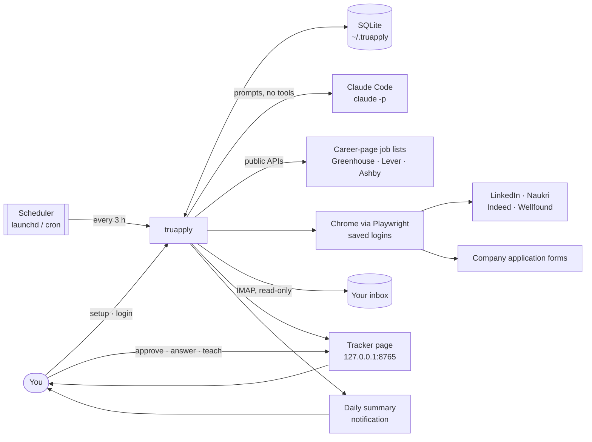

# TruApply docs

*Tru* is for "true". TruApply never lies for you.

TruApply is an open-source job-application assistant that runs on your own computer. It finds jobs that fit you, tailors your resume to each one using only true facts, fills in and submits the application, reads your inbox for replies, and learns from your answers, approvals, edits and replies. It starts by asking you to approve each application, and offers to submit on its own only once it has earned your trust. It uses **Claude Code** (installed on your machine, with your own login) as its AI. Nothing runs on a server we host.

## Read in this order

| Doc | What's in it |
|---|---|
| [plan.md](plan.md) | Goal, target numbers, scope, and the build phases, each with must-pass tests |
| [architecture.md](architecture.md) | How it's built: modules, data, diagrams, the AI calls, the form filler, the resume checks |
| [outcomes.md](outcomes.md) | Learning from your input, reply tracking, learning from results, the daily summary |
| [setup-questions.md](setup-questions.md) | Every question a new user is asked, and the defaults |
| [safety.md](safety.md) | No made-up experience, questions never guessed, trust before auto-submit, untrusted job pages, account risk, privacy |
| [risks.md](risks.md) | The what-if list: everything that can go wrong and what the tool does about it |
| [examples.md](examples.md) | Real samples: profile, AI prompt and reply, form answers, resume changes, tracker, summary, logs |
| [CONTRIBUTING.md](CONTRIBUTING.md) | Coding rules, dev setup, tests, how to add a job site or a company, how to report a broken site |
| [extension.md](extension.md) | Plan for the Chrome extension that fills forms in your own browser |

## Words used in these docs

| Word | Meaning |
|---|---|
| **ATS** | Applicant tracking system: the software companies use to post jobs and collect applications (Greenhouse, Lever, Ashby, Workday …) |
| **Career pages** | Jobs posted directly on a company's ATS board. No login is needed to read or apply. |
| **Board** | One company's job list on an ATS, e.g. `greenhouse/vercel` |
| **Dry run** | Does everything except clicking the final Submit and uploading files |
| **Review queue** | Mode where every filled application waits for you to approve it |
| **Tracker page** | The local page at `127.0.0.1:8765` (`truapply tracker`) where you approve, answer, dismiss and teach TruApply |
| **Finish these** | Jobs whose site wants a human check (a CAPTCHA, a picture puzzle or an emailed code). They open in the filled-in browser, and you submit them yourself. |
| **Filled-in browser** | One window with a tab for every job waiting for you, filled in and stopped before Submit. It opens after a run, or from **Open it filled in**. |
| **Trust count** | Your approvals in a row with no edits. An edit or a 👎 resets it. |
| **Auto-submit** | Sending strong matches (score 80 or more) without waiting for your OK. Suggested at a trust count of 20 (or turn it on sooner), and only on when you turn it on. |
| **Tell TruApply** | A box on the tracker for rules in plain words, like "no staffing agencies". They change scoring, never your facts. |
| **Master resume** | Your original resume. It's the only source of facts. |
| **Outcome** | What happened after applying: confirmed, rejected, assessment, interview, offer, or ghosted (no reply) |
| **Must-pass test** | A check a build phase has to pass before the next phase starts |
