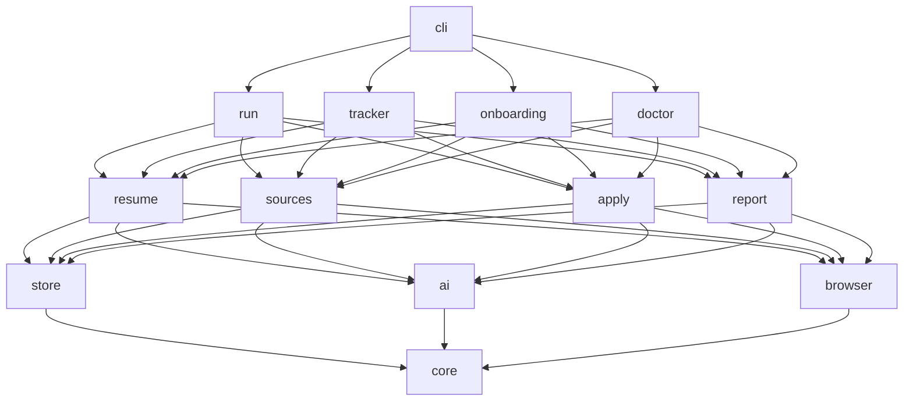
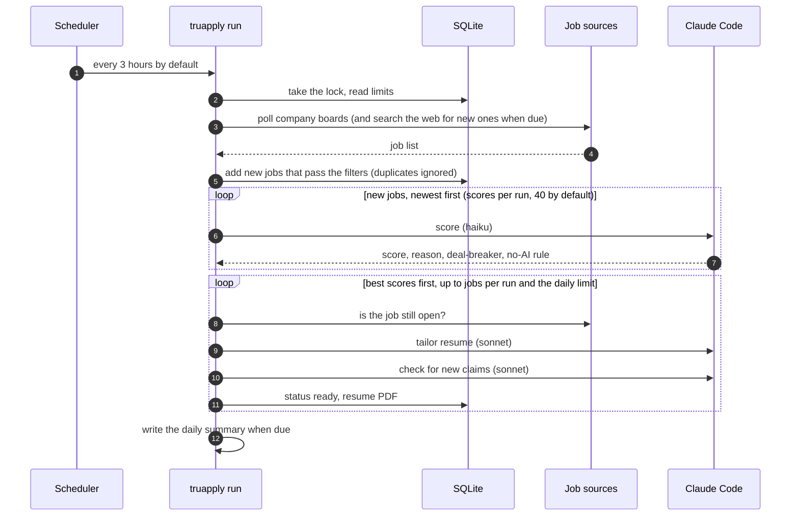
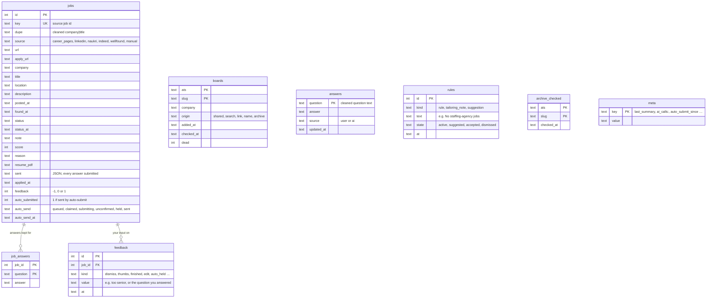
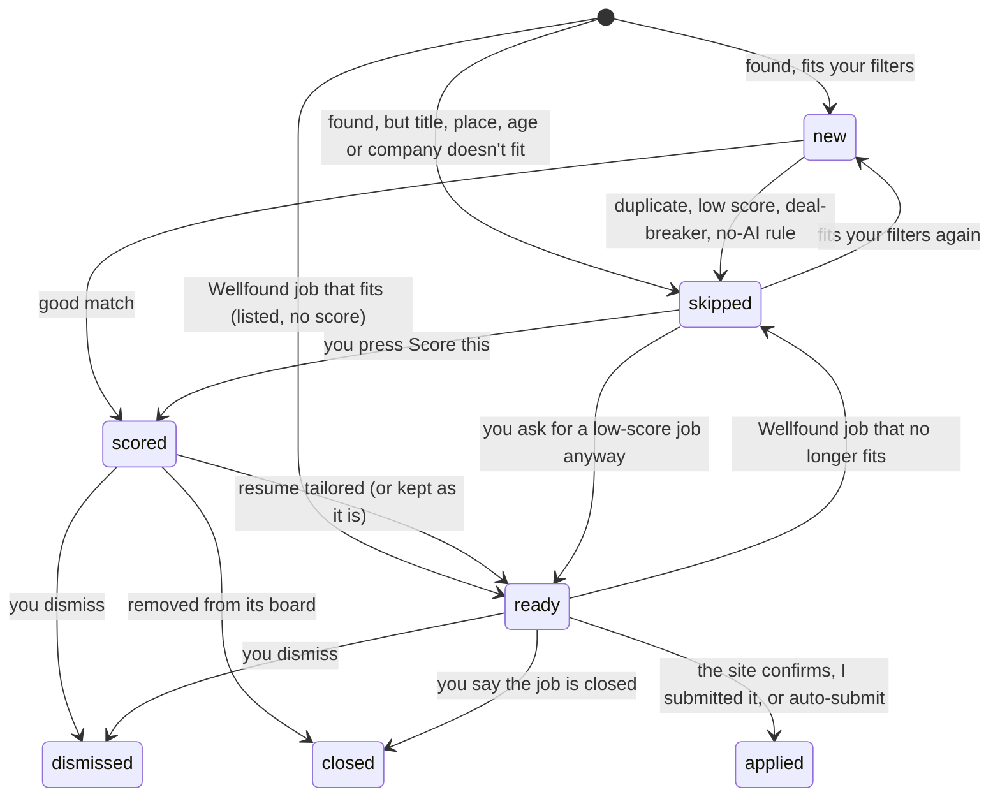
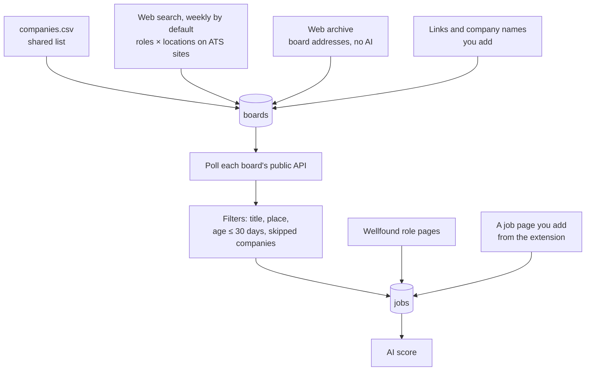
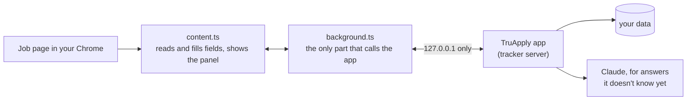
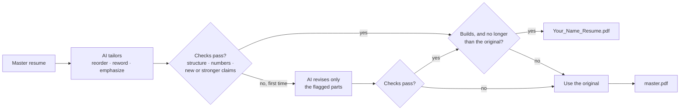

# Architecture

**Design rule:** one runtime dependency (Playwright), with the Python standard library for everything else. Every extra moving part is something that breaks on a user's machine.

## Stack

| Need | Choice | Why |
|---|---|---|
| Language | Python 3.11+ | Easy for contributors to install |
| Filling forms | A Chrome extension in **your own Chrome** (`web/extension/`, TypeScript) | Sites see a normal browser with your history, and you check every form and press Submit |
| Background browser | Playwright with headless Chrome (Chromium if Chrome is missing), no saved profile | Only for resume PDFs and fetching job-board pages; it never logs in anywhere |
| Storage | SQLite (`sqlite3`) | One local file, no server, survives crashes |
| AI | Claude Code CLI (`claude -p`) | Uses the user's own Claude login; no API key needed |
| Resume PDF | `pdflatex` for `.tex` resumes; Chrome's print-to-PDF for the rest | No extra install unless the resume is LaTeX |
| Tracker page | `http.server` with a JSON API, serving a React app (`web/`) that's built once and shipped inside the package | No Python web framework, and users don't need Node |
| Diff view | `difflib.unified_diff` | Built into Python |
| Notifications | `osascript` (macOS), a PowerShell toast (Windows), `notify-send` (Linux) | Built into the OS |
| Scheduling | launchd (macOS), Task Scheduler (Windows), cron (Linux) | Built into the OS |

## Repo layout

Package by feature. Each package has one job, and each module stays small (about 300 lines at most).

```
truapply/
  __main__.py
  cli.py                 command-line entry
  doctor.py              health checks behind `truapply doctor`
  run/                   one run: discovery.py · scoring.py · tailoring.py · rescoring.py
                         · context.py · lock.py (one run at a time) · archive_check.py
  core/
    models.py            Job, Status, Source, Board, duplicate keys
    documents.py         ResumeData (built-in design), ResumeDocument, ResumeFormat
    profile.py           Profile, Settings and their parts; load, validate, save
    forms.py             form fields, answers and what was sent
    codec.py             dataclass ⇄ JSON and JSON Schema, with exact error paths
    errors.py            TruApplyError and its subclasses, each with a hint
    paths.py             the ~/.truapply layout
    schedule.py          the launchd job (macOS) or the cron line (Linux) for background runs
    tasks.py             the Task Scheduler task (Windows) for background runs
    autorun.py           picks launchd or Task Scheduler for this computer
    archive_task.py      starts the web archive check as its own process
    locks.py · clock.py · notes.py · notify.py · tailscale.py
    files.py             atomic, private (0600) file writes
    numbers.py           the number check shared by resumes and form answers
    logs.py              logging setup
  store/
    db.py                connection, migrations runner
    migrations.py        numbered schema steps
    jobs.py              jobs, statuses, duplicates
    boards.py            company job boards and how each was found
    answers.py           saved answers (yours or the AI's) and the answers kept per job
    records.py · browse.py · groups.py   jobs as the tracker shows them, paging and filters, pipeline counts
    feedback.py          every action you take on the tracker
    rules.py             rules, tailoring notes and suggestions
    autosend.py          the auto-submit queue
    archive.py · usage.py · meta.py   archive checks, daily Claude calls, small key-value state
  ai/
    client.py            the only place that runs `claude -p`: flags, sandbox, timeout, retry
    budget.py            the daily Claude call budget
    replies.py           typed replies; their JSON schemas are generated from these
    prompts.py · job_prompts.py · context.py   prompt builders
    tasks.py             ping, draft_profile, convert_resume, rewrite_latex, rewrite_structured,
                         revise_latex, revise_structured, review_claims, score_job,
                         find_posting_urls, answer_fields, read_posting
  browser/
    chrome.py            headless Chrome, falling back to Chromium
    pdf.py               offline, script-free HTML → PDF
    fetch.py             concurrent JSON and page fetching on Playwright's network stack
  resume/
    contract.py          the Resume protocol, Draft, Rendered
    latex.py             LatexResume: split, body checks, render
    structured.py        StructuredResume: built-in design, entry checks, render
    style.css            the built-in design
    render.py            sandboxed pdflatex, log parsing
    packages.py          installs missing LaTeX packages with tlmgr
    tailor.py            the tailoring pipeline and fallback
    master.py            loads the master resume, caches its PDF by content hash
    storing.py           keeps a new master resume
    importer.py          reads .tex, .pdf, .docx, .md, .txt
    diff.py              changed lines
  sources/
    ats/                 greenhouse.py · lever.py · ashby.py, behind one AtsReader shape (base.py)
    discover.py          the shared company list
    intake.py            polls boards and adds the jobs that fit
    filters.py · skills.py   title, location, age, skipped-company and skill filters
    lookup.py            company names or websites → boards
    archive.py           board names from the Common Crawl index
    pages.py             a job page address → its site and job id (LinkedIn, Naukri, Indeed …)
    wellfound.py         Wellfound role pages
    text.py              defensive JSON and HTML-to-text helpers
    companies.csv        shared list of company career boards
  apply/
    answering.py         answers for a form's fields: saved answers, profile facts, then the AI
    profile_facts.py     name, email, links, years and other answers straight from the profile
    options.py           matching an answer to a dropdown, radio or search-as-you-type option
    claims.py            the number check on AI answers and cover letters
  tracker/
    server.py            127.0.0.1 only: Host, Origin, JSON and size checks, security headers
    views.py · routes.py · responses.py · body.py   address → handler, JSON in and out
    listing.py           summary, job lists, the board and the workflow counts
    detail.py            one job as JSON, and which actions its status allows
    actions.py           job actions: dismiss, 👍/👎, I submitted it, revert, score, tailor
    extension.py         the API the Chrome extension calls
    autosend.py          auto-submit: the next job to send, holds, the queue
    learning.py          rules, tailoring notes, suggestions, saved answers
    runs.py · run_report.py   runs from the page, and the report read from a run's log
    settings.py · settings_fields.py · automatic.py   settings, and automatic runs on or off
    setup.py             first-run setup from the page: read the resume, ask the rest, save the profile
    resume_upload.py     a new master resume from the page
    companies.py · linking.py   the Companies page, adding boards by link or name
    static.py            serves the built app (static/, made by `npm run build`, not in git)
    plain.py             readable resume changes, with LaTeX commands stripped
  extension/             the built Chrome extension (made by `npm run build`, not in git)
  report/
    summary.py           the daily summary file and notification
  onboarding/
    wizard.py            the terminal setup flow (`truapply setup`)
    steps.py             each group of setup questions
    ask.py               terminal prompts, amount and date parsing
    latex.py             TinyTeX install
web/                     the tracker app: React + TypeScript, built with Vite into tracker/static/
  src/api/               the JSON API: shapes, fetch client, TanStack Query queries and mutations
  src/app/               layout, routes (each page loads as its own chunk), theme
  src/features/<page>/   one folder per page: home, jobs, job, companies, runs, learned, settings, setup
  src/components/        parts shared by pages: job list, status pill, rule and dismiss forms, extension steps
  src/ui/                design-system parts on Base UI: buttons, fields, dialog, toasts, calendar, icons
  src/domain/            status, group and filter labels
  src/lib/               router, small zustand stores, formatting
  extension/             the Chrome extension: manifest.json and src/*.ts, built into truapply/extension/
tools/
  check_no_comments.py
tests/
  unit/ · test_architecture.py
  e2e/                       (real headless browser: the tracker app, and the extension on a test page)
  ai/                        (live Claude, `pytest -m ai`)
  live/                      (live job-board APIs and real forms, `pytest -m network`)
docs/
```

### Layers

A package may only import from layers below it. `tests/test_architecture.py` enforces this.



## User data (never in the repo)

Everything personal lives in `~/.truapply/`, or wherever `TRUAPPLY_HOME` points:

```
~/.truapply/
  profile.json          setup answers (validated on every load); setup isn't done until it exists
  setup.json            the setup draft while first-run setup is in progress
  resume/master.tex     or master.json (built-in design): the original, the only source of facts
  resume/master.pdf     built once per version of the master; used whenever tailoring fails
  previews/<job>/       resumes made with `truapply tailor`
  truapply.db           jobs, boards, answers, feedback, rules, settings state
  resumes/<job id>/     tailored source + <Your_Name>_Resume.pdf for that job
  summaries/<date>.md   daily summaries
  runs/<time>.log       the output of each run started by the schedule or the tracker
  run.log               anything a scheduled run prints before its own log opens
  run.lock              held while a run is going
  archive.log           the output of the web archive check
  archive.lock          held while the web archive check is going
```

---

## How one run works

A run finds jobs, scores them and tailors your resume for the best ones. It never opens an application form. Forms are filled later, in your own Chrome, by the extension.



## Data model



A career-page job's board is part of its key (`career_pages:<ats>/<slug>/<job id>`), so `jobs` has no separate board column.

Two keys stop duplicates:

- `key` = `source:job id`. The same posting is never added twice.
- `dupe` = cleaned-up `company|title`. When the same job is already `ready` or `applied` from another source (say LinkedIn and Greenhouse), the new copy is skipped as a duplicate before scoring.

Schema changes go through numbered migrations in `store/migrations.py`; SQLite's built-in `pragma user_version` records which ones have run. A database newer than the app is refused, never guessed at. Timestamps are ISO 8601 text in UTC.

Migration 5 moved jobs from the old statuses of the earlier form filler into `ready` and dropped the old `questions` table. Later migrations add `job_answers` (the AI's answers for one job, so a refill doesn't ask again), `jobs.auto_send` / `auto_send_at` (auto-submit) and `archive_checked`.

### Job status

There are seven statuses (`core/models.py`).



`ready` means the resume is ready and the job waits for you to apply in your Chrome. When the extension sees a site's confirmation after you press Submit, it marks the job `applied`, whatever its status was. A dismissed job is never applied to.

---

## Module contracts

The functions other packages use. Data types live in `core/`.

```python
store.db.connect(path: Path) -> sqlite3.Connection
store.jobs.add_many(db, jobs: Iterable[Job], now: datetime) -> int
store.jobs.find(db, job_id: int) -> Job | None
store.jobs.set_status(db, job_id: int, change: StatusChange) -> None
store.jobs.is_duplicate(db, job: Job) -> bool

ai.client.ask(reply_type: type[T], request: Request) -> T
ai.tasks.ping() -> bool
ai.tasks.draft_profile(document: ResumeDocument) -> ProfileDraft
ai.tasks.convert_resume(document: ResumeDocument) -> ResumeData
ai.tasks.rewrite_latex(preamble: str, body: str, job: Job, notes: Sequence[str]) -> LatexRewrite
ai.tasks.rewrite_structured(resume: ResumeData, job: Job, notes: Sequence[str]) -> StructuredRewrite
ai.tasks.review_claims(original: str, tailored: str) -> tuple[str, ...]
ai.tasks.score_job(profile: Profile, resume_text: str, job: Job, preferences: Sequence[str] = ()) -> Score
ai.tasks.find_posting_urls(profile: Profile) -> tuple[str, ...]
ai.tasks.answer_fields(context: FormContext, fields: Sequence[Field]) -> FormAnswers
ai.tasks.read_posting(page_text: str) -> Posting

resume.master.load_resume(profile: Profile) -> Resume
resume.master.master_pdf(paths: Paths, resume: Resume) -> Rendered
resume.tailor.tailor(resume: Resume, request: TailorRequest, review: ClaimReviewer = ...) -> Tailored
resume.diff.changed_lines(original: str, tailored: str) -> list[str]

sources.ats.poll(boards: Sequence[Board]) -> PollResult
sources.ats.board_of(url: str) -> Board | None
apply.answering.answer_form(context: FormContext, fields: Sequence[Field],
                            known: Mapping[str, str], answer: Answerer | None) -> FormReply

core.profile.load(paths: Paths) -> Profile
core.profile.save(paths: Paths, profile: Profile) -> None
core.codec.decode(cls: type[T], data: object) -> T
core.codec.json_schema(tp) -> dict[str, object]
```

`ai.client.ask` raises `AIError` (a bad reply after one retry), `UsageLimitError` (the run stops cleanly) or `ClaudeUnavailableError`.

---

## AI calls

Every call goes through `ai/client.py`:

```
claude -p --safe-mode --tools "" --strict-mcp-config --no-session-persistence \
       --permission-prompts none --model <haiku|sonnet> \
       --system-prompt <…> --json-schema <…> --output-format json      (prompt on stdin)
```

| Flag | Why |
|---|---|
| `--safe-mode` | The user's own Claude Code plugins, hooks, MCP servers and CLAUDE.md files are not loaded |
| `--tools ""` | No file access, commands or browsing. Job text is untrusted (see [safety.md](safety.md)). The two tasks that need a tool get only that one. |
| `--json-schema` | The reply comes back as structured JSON, which the code validates |
| prompt on stdin | Long job descriptions and resumes fit |

| Task | Model | Tools | When |
|---|---|---|---|
| Read the resume into a profile draft | sonnet | Read (the resume file only, when it can't be read as text) | setup |
| Turn a non-LaTeX resume into the built-in design | sonnet | Read, as above | setup, or a new resume |
| Find company career boards | haiku | WebSearch | with **Search the web for new companies** (every day, every week by default, or never), or right away from **Search with AI** |
| Score a job | haiku | none | each new job that passes the filters |
| Tailor the resume, and revise it once if a check fails | sonnet | none | each good match a run gets ready |
| Check the tailored resume for new or stronger claims | sonnet | none | after tailoring (the last guard against made-up facts, so accuracy beats cost) |
| Answer form fields (and write the cover letter when needed) | sonnet | none | when the extension fills a form and a field has no saved answer or profile fact |
| Read a job page that has no job data | haiku | none | when you add a job from the extension and the page has no `JobPosting` data |

**What you taught it goes in as data.** Every scoring call gets your active **Tell TruApply** rules as the candidate's preferences, and every tailoring call gets your tailoring notes. Neither can add a fact: facts still come only from the master resume and your notes from setup.

**Budget:** a job takes a few calls (score, tailor, claim check, form answers), and fewer over time as saved answers build up. With **Send it as it is** in place of tailoring, a run skips the tailoring calls. A daily budget for calls in a run (default 300) stops runaway use. When Claude reports a usage limit, the run stops cleanly; the rest waits for the next run.

---

## Finding jobs



| Source | Found by | Applied by |
|---|---|---|
| Greenhouse / Lever / Ashby | Shared list, web search, the web archive, and links or names you add; then the public job-list APIs | You, in your Chrome, with the form filled by the extension (or by auto-submit, when it's on) |
| LinkedIn, Naukri, Indeed, any other site | Only a job page you open and add from the extension's panel (`sources/pages.py`, `POST /api/extension/add`). TruApply never searches these sites. | You. On a page the extension doesn't start on by itself, click its toolbar icon to fill the form |
| Wellfound | Its public role pages (`/role/l/<role>/<country>`, and `/role/r/<role>` when you'd work remote abroad) for **Wellfound roles to read** (or your roles), up to 5 pages each, 2 at a time, every run; no login. A 429 pauses Wellfound for an hour | Not applied by the app: jobs whose title has one of **Pull jobs whose title has** (or your roles and title keywords) and none of **Skip jobs whose title has**, that fit your years of experience (Wellfound's own minimum, with 1 year of stretch) and name skills on your resume, are listed as **Ready** on their own tab with no score and no tailored resume, and you apply on Wellfound yourself |

**Shared company list** (`truapply/sources/companies.csv`): `ats,slug,company,tags`. It ships with the package, starts with 693 boards (104 tagged `india`, 105 tagged `remote`), and grows by pull requests. `truapply boards --new` prints boards you found that aren't in it yet.

**Fetching:** board APIs are read through Playwright's own network stack in headless Chrome (so HTTPS works even where Python's certificate store is missing), at most 8 at a time. A board that returns 404 is marked dead; one that doesn't answer is just retried next run.

**AI calls in a run:** scoring and tailoring run up to 4 jobs at a time (`PARALLEL_AI_CALLS`); every database write stays on the main thread. Two copies of the same job in one batch are not both scored: the second is skipped as a duplicate.

**Before scoring,** cheap filters drop jobs whose title, location, age or company don't fit, so the AI only sees real candidates. Location rules: on-site in your city needs "on-site"; another city in your country needs "relocate" (and one of your cities, if you listed any); remote in your country (or a region that includes it, like "APAC") needs "remote in country"; plain "Remote" or "Worldwide" fits either remote choice. Remote tied to another place ("Remote US", "Remote - Europe", "Remote within Canada") means you must live there, so it doesn't fit. A location with several places ("Bengaluru / Pune", "Remote Canada; Remote US") fits when any one of them does. Ashby marks hybrid jobs as remote too, so its reader uses the job's workplace type and ties "Remote" to each listed place. A job in your field that fails a filter is kept as `skipped`, and comes back as `new` if a later change makes it fit.

**Before tailoring,** each job is checked against its board API again, so a removed job is marked `closed` instead of getting a resume.

### The ATS reader contract

Adding an applicant tracking system means adding one module in `truapply/sources/ats/` that defines a `READER: AtsReader` (from `sources/ats/base.py`) and listing it in `sources/ats/__init__.py`:

```python
@dataclass(frozen=True)
class AtsReader:
    ats: Ats
    board_url: re.Pattern[str]
    list_url: Callable[[str], str]
    posting_url: Callable[[str, str], str | None]
    parse: Callable[[Board, object], list[Job]]
```

| Field | Meaning |
|---|---|
| `ats` | Which system this is (`greenhouse`, `lever`, `ashby`) |
| `board_url` | Matches a job or board link on this system; group 1 is the board name |
| `list_url` | The public job-list API address for a board name |
| `posting_url` | The API address for one job, to check it's still open; `None` checks the job list instead |
| `parse` | Turns the API's JSON into `Job`s |

See [CONTRIBUTING.md](CONTRIBUTING.md#adding-an-ats) for the full checklist.

---

## Filling forms (the Chrome extension)

The extension lives in `web/extension/` and is built into `truapply/extension/`, which you load in Chrome from **Settings → Resume and extension** (or the last setup step). It runs in your own Chrome and talks only to the app on `127.0.0.1`.



- **Where it starts:** by itself on Greenhouse, Lever and Ashby pages and on LinkedIn job pages. On any other site it runs only when you click its toolbar icon.
- **What it shows:** a small panel with the job and its status. A job TruApply doesn't know can be added (**Add to TruApply**); the app then scores it and gets its resume ready, which takes about a minute. Added from the toolbar icon, it's filled right away with your original resume instead. A `ready` job fills as soon as its form shows.
- **Reading fields** (`fields.ts`): every visible field, with its label as a person sees it, its kind, choices and whether it's required.
- **Answers** (`POST /api/extension/jobs/<id>/answers`, `apply/answering.py`): saved answers and profile facts first, then Claude for the rest. Every number in an AI-written answer or cover letter must appear in the resume or the profile facts; if one doesn't, Claude is asked once more, and an answer that still fails is left out. Consent and agreement boxes, other file uploads, and legal questions your profile doesn't answer are never filled; they're listed as "left for you" and outlined in yellow.
- **Filling** (`fill.ts`): text, dropdowns (including click-to-open ones), radios, checkboxes, dates and search-as-you-type fields, set the way the site's own code expects. The resume field gets the job's tailored PDF (or your original). It fills in up to 4 rounds, so a field that appears after an answer is filled too.
- **After Submit:** you check the form and press Submit. When the site shows its confirmation and the form is gone, the job becomes `applied`, with every answer sent stored in `jobs.sent`. Answers you typed or changed yourself (except long text and files) are saved as your answers for next time.
- **Auto-submit** (only while it's on): every minute, after each send, and when you press **Send these with auto-submit**, the extension asks the app for the next job (`POST /api/extension/send/next`). The app hands one out only when no run is going and no other send is in progress. The extension opens it in a new tab, fills it, and presses Submit only when nothing is left for you, no human check shows and there's exactly one Submit button. Otherwise it tells the app why (`/held`) and leaves the tab filled in for you.

The extension never solves a CAPTCHA, never ticks a consent box, and never presses Submit unless auto-submit is on.

## Resume pipeline (`resume/`)



When a check fails, the exact problems go back to the AI once, and it fixes only those parts by going back to your original wording. A second failure means the original is used. A failed tailoring never blocks the job, and the reason is shown in the tracker's change view.

With **Tailor it to each job** off (`settings.tailor_resume`), a run skips the AI and gets each job ready with your original resume.

## Background runs

- `truapply schedule` writes a launchd job (`~/Library/LaunchAgents/com.truapply.run.plist`) that runs `truapply run --scheduled` at set times of day, every `settings.run_every_minutes` (180, at least 15) minutes counted from midnight. A time missed while the computer sleeps runs once when it wakes. On Windows it's a Task Scheduler task (`TruApply`, saved as `%LOCALAPPDATA%\TruApply\truapply-task.xml`) with the same times, run with `pythonw` so no window opens. The Activity page shows the next set time. On macOS and Windows, turn it on or off in **Settings → Automation**. On Linux it prints a cron line to add with `crontab -e`. `truapply unschedule` removes it.
- The schedule runs for one data folder. **Settings → Automation** shows automatic runs as on only for that folder; for any other `TRUAPPLY_HOME` it says they run for a different folder (`tracker/automatic.py`, `elsewhere`).
- A scheduled run writes its output to `runs/<time>.log`, so it shows on the tracker's Activity page next to runs started there.
- One run at a time: `run/lock.py` holds a lock on `run.lock` (`fcntl` on macOS and Linux, `msvcrt` on Windows) for the whole run. A second run, from the schedule, the tracker or the terminal, stops with "Another run is already running." The lock is released automatically if the process dies.
- Auto-submit and crashes: each job auto-submit takes is tracked in `jobs.auto_send`. A claim or a press that doesn't finish within 15 minutes becomes `held` or `unconfirmed`, and auto-submit never picks either again, so a job is never sent twice.
- Limits: jobs made ready per run (`settings.jobs_per_run`, 5), jobs scored per run (`settings.scores_per_run`, 40), a daily total (`daily_cap`), LinkedIn ≤ `settings.linkedin_cap` (10) a day, counted separately, and the daily Claude call budget (`settings.ai_calls_per_day`, 300). Every Claude call in a run is charged before it starts. When the budget is spent the run stops cleanly and picks up again tomorrow; the sidebar and Activity say so, and the budget is in **Settings → Applying → Claude calls per day**. Calls are counted per local day in `meta` (`ai_calls:<date>`).
- The daily summary: the first run after `settings.summary_hour` (20:00) writes `summaries/<date>.md` and shows one notification with how many jobs were applied to and how many are ready for you. It's sent once a day (`meta.last_summary`).

## Tracker page (`tracker/`)

- `truapply tracker` serves `http://127.0.0.1:8765` (or a free port if 8765 is taken). It's only reachable from your own machine. It also answers your private Tailscale address when `tailscale status` has one (`core/tailscale.py`), or a name given with `--allow-host`, so you can open it from your phone through `tailscale serve`; see [other-devices.md](other-devices.md).
- The Python side is a JSON API on `http.server`, described in [tracker-api.md](tracker-api.md). `server.py` does the checks, `views.py` and `routes.py` send each address to its handler, and each feature has its own module of routes.
- The page is a React + TypeScript app in `web/`. It's built with Vite into `tracker/static/` and shipped inside the package, so users never need Node. Every API call goes through TanStack Query; the theme, the time format and which tabs you've seen live in small zustand stores. The Jobs page shows a list with the picked job beside it; **All jobs** shows the same jobs as a table. The table uses TanStack Table for its columns, sorting and row selection, while paging, sorting, search and filters run on the server and live in the address, so Back and reload keep your place. Each page loads as its own chunk, and its data is fetched as soon as you point at its link.
- The sidebar has Today, Jobs, All jobs, Companies and Activity, then Learned and Settings, one box with the run (next run, Run now, or the live stage while a run goes; when the last run ended with an error, a red **Last run stopped** note with the reason, linking to Activity) and the light or dark mode switch. The app follows your system's mode until you pick one. The brand colour is Midnight.
- While a run is going, the tab icon gets an amber dot (`favicon-running.svg`), so you can see it from another tab.

### Pages

Until setup is done (no `profile.json` yet), every address shows the setup page.

| Page | Address | What's on it |
|---|---|---|
| **Set up** | `/setup` | First-run setup in 5 steps: your resume (Claude reads it into a draft), your details, rights and pay, how it runs (tailoring, jobs per run, automatic runs) and the extension. Finishing saves the profile, adds the shared company list and, if you chose it, turns on automatic runs. Other pages stay locked until then |
| **Today** | `/` | The jobs ready for you to apply, **Send these with auto-submit**, the pipeline counts (found, not a fit, good matches, ready, applied), each opening those jobs, and recently applied jobs |
| **Jobs** | `/jobs` | Jobs from every site, Wellfound included, tagged with their site. A status bar, search and a **Filter** menu for the site (**All sites** by default, **Career pages** with `/jobs?sites=career`, or one listed-only site) and status. A pipeline number from Today shows career-page jobs only, to match its count. The list opens the picked job beside it (J and K to move) (e.g. `/jobs?group=not_a_fit` from a pipeline number on Today) |
| **All jobs** | `/jobs/table` | The same jobs as a table, laid out like Companies: search and one **Filter** menu (Site: All sites, Career pages or a listed-only site at `/sites/<site>/table`; Show: Active, Ready, Matches, Applied, All and any other status), **Add a job link** on the right, column filters, sorting, and selecting rows to score or dismiss many at once |
| **Wellfound** | `/sites/wellfound` | Only while **List Wellfound jobs on every run** is on, picked from the **Site** menu: the same page for Wellfound jobs, without scores |
| **Job** | `/jobs/<id>` | Status, score and "why this score", 👍/👎, the controls below, what was sent, the resume PDF, a readable **What changed** view (LaTeX commands stripped, so you read words, not markup) and the job text |
| **Companies** | `/companies` | Every company whose job list is checked on each run, 50 to a page: its site, how it was found (came with the app, web search, the web archive, your job link or a name you added), its jobs for you, when it was added and last checked, and closed ones. Filter with **All** and **Closed**, or **Found by** for how it was found. **Add companies** looks up pasted names or websites; **Search the web archive** reads the archive in the background, beside any run, with no AI; **Search with AI** starts a run that searches the web right away |
| **Activity** | `/runs` | Start a run (how many jobs, search first), or while one goes its stage (find, score, tailor), live log and Stop; the next automatic run, recent runs, and the last run: its numbers (companies checked, jobs that fit, new jobs, good matches), the jobs made ready, each scored job with its result and reason |
| **Run log** | `/runs/<log>` | The full log of one run |
| **Learned** | `/learned` | Your rules, tailoring notes, saved answers (from you or from the AI, with a search box) and suggestions. Each can be edited or deleted. |
| **Settings** | `/settings` | Tabs: **Profile** (about you, work rights, personal details, more facts), **Job search** (titles, places, pay and notice period, Wellfound), **Applying** (form answers, tailor or send your resume as it is, auto-submit, runs and limits), **Automation** (automatic runs, time format) and **Resume and extension** (replace the master resume, install the Chrome extension) |

### What you can do on a job page

Each action is a JSON POST to `/api/jobs/<id>/<action>`, and the ones that teach it something are recorded in the `feedback` table (see [outcomes.md](outcomes.md#1-learning-from-you)).

| Action | Allowed when | What happens |
|---|---|---|
| **Open in my Chrome** | the job has a link | Opens the application page; the extension fills it |
| **Dismiss**, with a reason: wrong role, too senior, too junior, location, salary, company, job is closed, other | `scored` or `ready` | → `dismissed` (or `closed` for "job is closed"). It's never applied to. |
| **👍 / 👎** (`thumbs`) | any status | Stored in `jobs.feedback`. With auto-submit on, a 👎 can turn it off (see below). |
| **I submitted it** (`finished`) | `ready` | → `applied`, for a job you sent some other way |
| **Use my original resume** (`revert`) | `ready`, with a tailored resume | Replaces the tailored PDF with your original, and asks for a tailoring note |
| **Score this** (`score`) | `new` or `skipped` | Scores it now, in the background |
| **Tailor my resume** (`tailor`) | `scored` | Starts a one-job run that gets it ready |

A button pressed on a stale page (the job's status changed after the page loaded) is refused, so it never changes a job by mistake.

### Adding a company by link

Paste a Greenhouse, Lever or Ashby job or careers link (the **Add a job link** button on All jobs, `POST /api/boards/link`, or `truapply add <link>`). Its board is saved with origin `link`, checked right away and on every run (`sources/intake.py`, the same intake a run uses). The job you pasted is kept even if your title or place filters would skip it; its other jobs go through the usual filters.

Or paste company names or websites (**Add companies** on the Companies page, `POST /api/boards/names`). `sources/lookup.py` turns each into a few board names (`Northwind Labs` → `northwindlabs`, `northwind-labs`, `northwind`; `example.com` → `example`), polls them on Greenhouse, Lever and Ashby at once, and keeps the first board with a job in your country, so a same-named company abroad isn't added. Found boards are saved with origin `name` and go through the usual intake.

### Companies from the web archive

[Common Crawl](https://commoncrawl.org) publishes a free archive of the web about once a month, with an index of every address it visited. `sources/archive.py` asks that index for every page it has on `job-boards.greenhouse.io`, `boards.greenhouse.io`, `jobs.lever.co` and `jobs.ashbyhq.com`, two pages at a time with up to 3 tries each, and reads the board names out of those addresses (`boards_in`, the same parser as pasted links). No AI is used.

- **When:** a run starts it on the same schedule as **Search the web for new companies** (never when that's off), or you start it from **Search the web archive** on the Companies page (`POST /api/companies/archive`) or `truapply archive`.
- **Beside runs, not in them:** it's its own process (`core/archive_task.py` starts it detached, `run/archive_check.py` does the work) with its own `archive.lock`, so one check goes at a time while runs carry on. It doesn't hold the run lock, uses no AI, and only adds boards; their jobs come in on the next run. Its output goes to `archive.log`.
- **Only new work:** a crawl already read in full is skipped. Names you already have are skipped, and names checked in the last 180 days are skipped (`archive_checked` table), so after the first time a month's crawl checks only its new names. If some index pages time out, the crawl isn't marked read and the next check tries again.
- **What's kept:** every new name's board is polled; boards with a job in your country are saved with origin `archive` and go through the usual intake. The rest are remembered as checked and looked at again after 180 days, in case they start hiring where you are.

### Learning and auto-submit

- **Tell TruApply** rules and tailoring notes (both written on the Learned page; a tailoring note also on a job's resume section) are stored in the `rules` table and used as described in [AI calls](#ai-calls). Suggestions are stored there too, as `suggested`, and change nothing until you accept them. See [outcomes.md](outcomes.md#1-learning-from-you).
- **Auto-submit** is a setting (`settings.auto_submit`, off by default; **Settings → Applying**). While it's on, the extension sends `ready` career-page jobs with a resume and a score at or above `settings.auto_submit_score` (80) that became ready after you turned it on, plus any you queue with **Send these with auto-submit**. Sent jobs are marked in `jobs.auto_submitted`. If 2 of the last 10 auto-submitted jobs get a 👎, auto-submit turns itself off. See [safety.md](safety.md#3-auto-submit).

### Security

- A POST must come from the tracker itself or from the TruApply extension (`Origin`: the tracker's own address, or `chrome-extension://<the extension's id>`, `EXTENSION_ORIGIN` in `tracker/extension.py`) and send JSON (`Content-Type: application/json`), so another website can't send one, not even a plain form. Any request whose `Host` isn't `127.0.0.1` or `localhost` on the tracker's port is rejected (this blocks DNS-rebinding tricks).
- A body over 200 KB is refused, except a resume upload, which has its own limit.
- Text from a job post or form comes back as plain strings, and React shows it as text, never as HTML. Links are returned only for `http(s)` addresses. A strict Content-Security-Policy allows nothing but the tracker's own scripts, styles and images.
- Files are served by job id, never by a path in the URL, and only from inside the data folder.
- The AI's score reason is kept in its own `reason` column, so later steps don't overwrite it.
