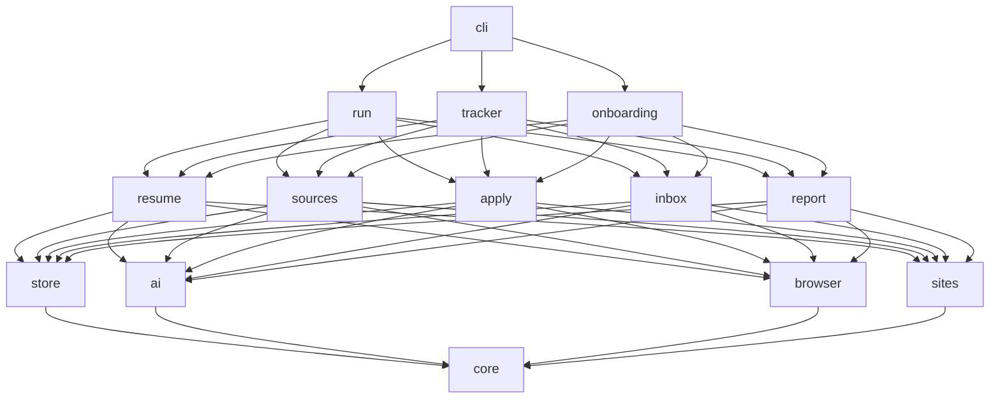
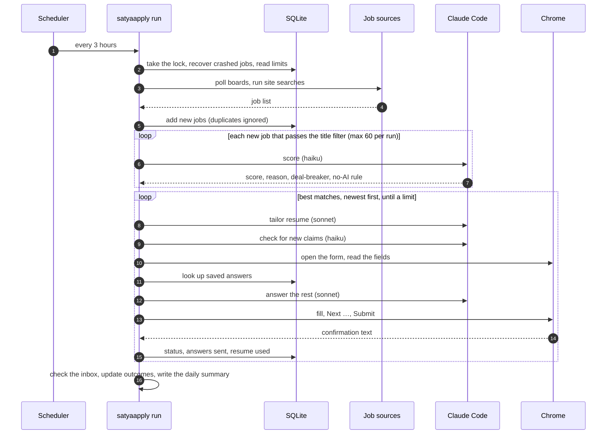
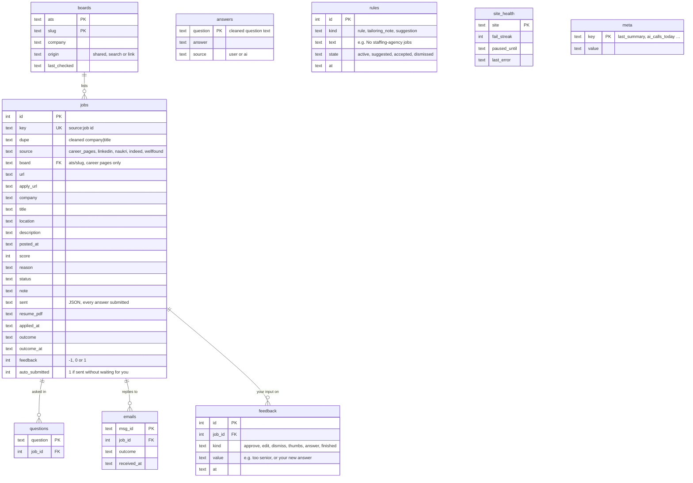
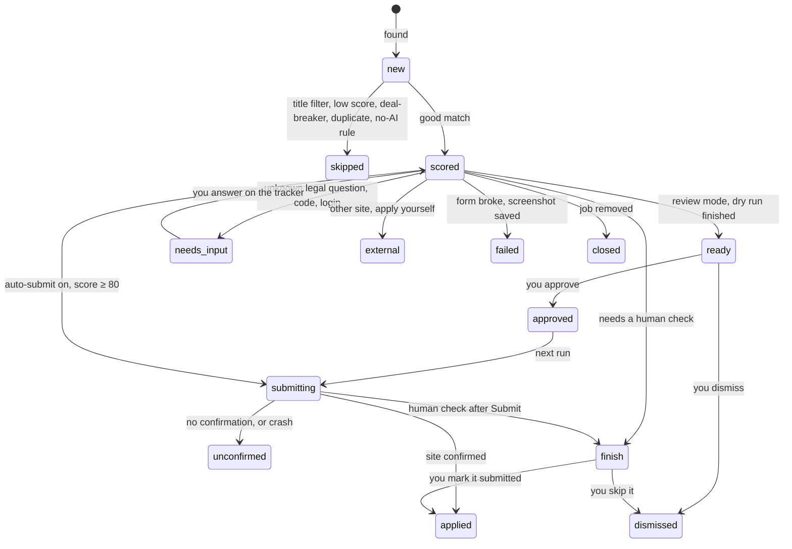
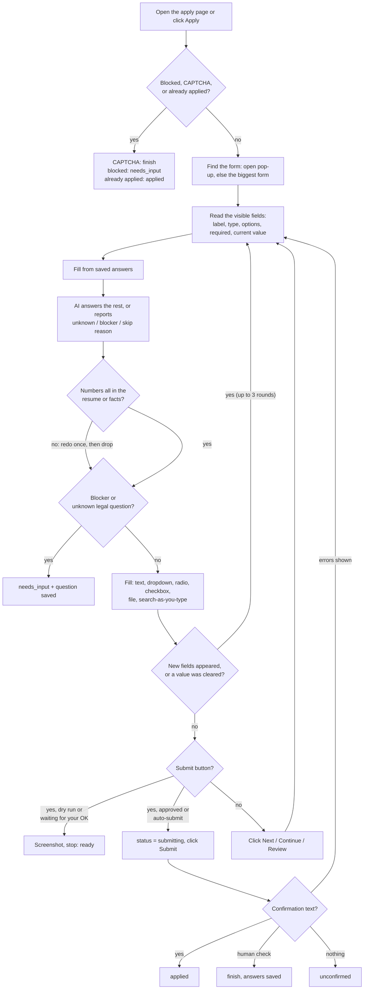
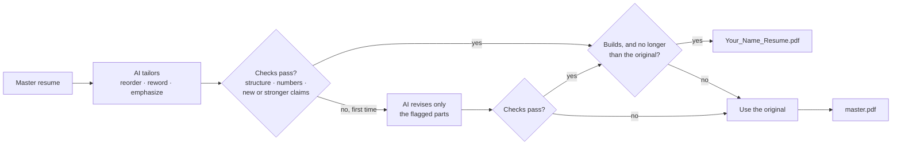

# Architecture

**Design rule:** one runtime dependency (Playwright), with the Python standard library for everything else. Every extra moving part is something that breaks on a user's machine.

## Stack

| Need | Choice | Why |
|---|---|---|
| Language | Python 3.11+ | Easy for contributors to install; good browser automation |
| Browser | Playwright driving the user's installed **Chrome**, with one saved profile | Real Chrome is less likely to be flagged as a bot; the saved profile keeps the logins |
| Storage | SQLite (`sqlite3`) | One local file, no server, survives crashes |
| AI | Claude Code CLI (`claude -p`) | Uses the user's own Claude login; no API key needed |
| Resume PDF | `pdflatex` for `.tex` resumes; Chrome's print-to-PDF for the rest | No extra install unless the resume is LaTeX |
| Email | `imaplib` + `email` | Built into Python; read-only access |
| Secrets | macOS Keychain (`security`), Linux `secret-tool`, otherwise a file only the user can read | Email passwords are never kept in plain files |
| Tracker page | `http.server` | No web framework needed |
| Diff view | `difflib.HtmlDiff` | Built into Python |
| Notifications | `osascript` (macOS), `notify-send` (Linux) | Built into the OS |
| Scheduling | launchd (macOS), cron (Linux) | Built into the OS |

## Repo layout

Package by feature. Each package has one job, and each module stays small (about 300 lines at most).

```
satyaapply/
  __main__.py
  cli.py                 command-line entry
  doctor.py              health checks behind `satyaapply doctor`
  run/                   one run: discovery.py · scoring.py · applying.py · submitting.py · context.py
  core/
    models.py            Job, Status, Source, duplicate keys
    documents.py         ResumeData (built-in design), ResumeDocument, ResumeFormat
    profile.py           Profile and its parts; load, validate, save
    codec.py             dataclass ⇄ JSON and JSON Schema, with exact error paths
    errors.py            SatyaApplyError and its subclasses, each with a hint
    paths.py             the ~/.satyaapply layout
    files.py             atomic, private (0600) file writes
    numbers.py           the number check shared by resumes and form answers
    logs.py              logging setup
  store/
    db.py                connection, migrations runner
    migrations.py        numbered schema steps
    jobs.py              jobs, statuses, duplicates
    answers.py           saved answers, yours or the AI's
    records.py           jobs as the tracker shows them
    feedback.py          every action you take on the tracker
    rules.py · trust.py  rules, tailoring notes and suggestions; the trust count
  ai/
    client.py            the only place that runs `claude -p`: flags, sandbox, timeout, retry
    replies.py           typed replies; their JSON schemas are generated from these
    prompts.py           prompt builders
    tasks.py             ping, draft_profile, convert_resume, rewrite_latex,
                         rewrite_structured, review_claims (scoring etc. in phase 2)
  browser/
    chrome.py            headless Chrome, falling back to Chromium
    pdf.py               offline, script-free HTML → PDF
    fetch.py             concurrent JSON fetching on Playwright's network stack
    session.py           headless persistent Chrome with its own profile
    page.py              waits, buttons by accessible name, screenshots
  resume/
    contract.py          the Resume protocol, Draft, Rendered
    latex.py             LatexResume: split, body checks, render
    structured.py        StructuredResume: built-in design, entry checks, render
    style.css            the built-in design
    render.py            sandboxed pdflatex, log parsing
    packages.py          installs missing LaTeX packages with tlmgr
    tailor.py            the tailoring pipeline and fallback
    master.py            loads the master resume, caches its PDF by content hash
    importer.py          reads .tex, .pdf, .docx, .md, .txt
    diff.py              changed lines
  sources/
    ats/                 greenhouse.py · lever.py · ashby.py, behind one AtsReader shape
    discover.py          the shared company list
    filters.py           title, location, age and skipped-company filters
    text.py              defensive JSON and HTML-to-text helpers
    companies.csv        shared list of company career boards
  apply/
    fields.js            reads every visible form field inside the page, labels as a person
                         sees them (CSS asterisks count as required; "autofill from resume"
                         boxes are skipped)
    errors.js            reads the form's error messages
    fields.py · fill.py  field values, and filling each field kind
    options.py           matching an answer to a dropdown, radio or search-as-you-type option
    claims.py            the number check on AI answers and cover letters
    detect.py            closed jobs, already applied, CAPTCHAs, confirmations
    opener.py            opens the application form
    flow.py              steps, fill rounds, saved answers, AI answers, Next/Submit, retries
    cover.py             cover letter PDF, offline
  sites/                 (phase 5)
  tracker/
    server.py            127.0.0.1 only: Host, Origin and size checks, security headers
    views.py · routes.py · responses.py   address → page or action, and the reply
    pages.py · html.py   HTML from data; escaping and the page shell
    actions.py           job page controls: approve, edit, dismiss, 👍/👎, answers, Finish these
    learning.py          Tell SatyaApply, tailoring notes, suggestions, What it learned
    trust.py             the trust panel and the auto-submit offer
    plain.py             readable resume changes, with LaTeX commands stripped
  inbox/ · report/       (phases 4, 6)
  onboarding/
    wizard.py            the setup flow
    steps.py             each group of setup questions
    ask.py               terminal prompts, amount and date parsing
    latex.py             TinyTeX install
tools/
  check_no_comments.py
tests/
  unit/ · test_architecture.py
  e2e/form.html · e2e/       (real headless browser on a local 3-step form)
  ai/                        (live Claude, `pytest -m ai`)
  live/                      (live job-board APIs, `pytest -m network`)
  fixtures/<site>/           (phase 5)
docs/
```

### Layers

A package may only import from layers below it. `tests/test_architecture.py` enforces this.



## User data (never in the repo)

Everything personal lives in `~/.satyaapply/`, or wherever `SATYAAPPLY_HOME` points:

```
~/.satyaapply/
  profile.json          setup answers (validated on every load)
  resume/master.tex     or master.json (built-in design): the original, the only source of facts
  resume/master.pdf     built once per version of the master; used whenever tailoring fails
  previews/<job>/       resumes made with `satyaapply tailor`
  satyaapply.db           jobs, answers, feedback, rules, emails, health, settings
  browser/              Chrome profile holding the site logins
  resumes/<job id>/     tailored source + <Your_Name>_Resume.pdf sent to that job
  shots/<job id>.png    screenshot on failure, block, or dry-run finish
  summaries/<date>.md   daily summaries
  run.log               output from background runs (no personal data)
```

---

## How one run works



## Data model



Two keys stop duplicates:

- `key` = `source:job id`. The same posting is never added twice.
- `dupe` = cleaned-up `company|title`. The same job on LinkedIn and on Greenhouse is only applied to once.

Schema changes go through numbered migrations in `store/migrations.py`; SQLite's built-in `pragma user_version` records which ones have run. A database newer than the app is refused, never guessed at. Timestamps are ISO 8601 text in UTC.

Migration 4 (the tracker, phase 3) adds `jobs.feedback`, `jobs.auto_submitted`, the `feedback` table (one row per action you take on the tracker) and the `rules` table (your **Tell SatyaApply** rules, tailoring notes and suggestions).

### Job status



`submitting` is written **before** Submit is clicked. If the process dies, the next run finds the job still in `submitting` at its start and marks it `unconfirmed`. It never submits it again (see [risks.md](risks.md)).

`finish` means the site wants a human check (a CAPTCHA or "verify you're human"). SatyaApply never solves it: whatever it filled in is saved, and you finish the job yourself (see [Finish these](#finish-these)). A human check after Submit always leads to `finish`, never to `unconfirmed` or `failed`.

Besides `ready` and `finish`, you can also dismiss a job that is `scored`, `needs_input`, `failed`, `unconfirmed` or `external`. A dismissed job is never applied to.

The outcome (`confirmed`, `rejected`, `assessment`, `interview`, `offer`, `ghosted`) is a separate field, filled in by reply tracking. See [outcomes.md](outcomes.md).

---

## Module contracts

The functions other packages use. Data types live in `core/`.

```python
store.db.connect(path: Path) -> sqlite3.Connection
store.jobs.add_many(db, jobs: Iterable[Job], now: datetime) -> int
store.jobs.find(db, job_id: int) -> Job | None
store.jobs.set_status(db, job_id: int, change: StatusChange) -> None
store.jobs.is_duplicate(db, job: Job) -> bool

ai.client.ask(reply_type: type[T], request: Request) -> T
ai.tasks.ping() -> bool
ai.tasks.draft_profile(document: ResumeDocument) -> ProfileDraft
ai.tasks.convert_resume(document: ResumeDocument) -> ResumeData
ai.tasks.rewrite_latex(preamble: str, body: str, job: Job, notes: Sequence[str]) -> LatexRewrite
ai.tasks.rewrite_structured(resume: ResumeData, job: Job, notes: Sequence[str]) -> StructuredRewrite
ai.tasks.review_claims(original: str, tailored: str) -> tuple[str, ...]

resume.master.load_resume(profile: Profile) -> Resume
resume.master.master_pdf(paths: Paths, resume: Resume) -> Rendered
resume.tailor.tailor(resume: Resume, request: TailorRequest, review: ClaimReviewer = ...) -> Tailored
resume.diff.changed_lines(original: str, tailored: str) -> list[str]

core.profile.load(paths: Paths) -> Profile
core.profile.save(paths: Paths, profile: Profile) -> None
core.codec.decode(cls: type[T], data: object) -> T
core.codec.json_schema(tp) -> dict[str, object]
```

Phase 2 and later add `store.answers`, `store.records`, `store.feedback`, `store.rules`, `store.trust`, `ai.tasks.score_job` / `answer_fields` / `classify_email` / `find_boards`, `sources`, `apply.flow.apply`, `inbox` and `report`, following the same style.

`ai.client.ask` raises `AIError` (a bad reply after one retry), `UsageLimitError` (the run stops cleanly) or `ClaudeUnavailableError`.

---

## AI calls

Every call goes through `ai/client.py`:

```
claude -p --safe-mode --tools "" --strict-mcp-config --no-session-persistence \
       --permission-prompts none --model <haiku|sonnet> \
       --system-prompt <…> --json-schema <…> --output-format json      (prompt on stdin)
```

| Flag | Why |
|---|---|
| `--safe-mode` | The user's own Claude Code plugins, hooks, MCP servers and CLAUDE.md files are not loaded |
| `--tools ""` | No file access, commands or browsing. Job text is untrusted (see [safety.md](safety.md)). |
| `--json-schema` | The reply comes back as structured JSON, which the code validates |
| prompt on stdin | Long job descriptions and resumes fit |

| Task | Model | Tools | When |
|---|---|---|---|
| Read the resume into a profile draft | sonnet | Read (resume folder only) | setup |
| Turn a non-LaTeX resume into a clean HTML resume | sonnet | none | setup |
| Find company career boards | haiku | WebSearch | once a day |
| Score a job | haiku | none | each new job that passes the title filter |
| Tailor the resume | sonnet | none | before each application |
| Check the tailored resume for new or stronger claims | sonnet | none | after tailoring (the last guard against made-up facts, so accuracy beats cost) |
| Answer form fields (and write the cover letter when needed) | sonnet | none | each form step with fields that have no saved answer |
| Classify a reply email | haiku | none | each job email |

**What you taught it goes in as data.** Every scoring call gets your active **Tell SatyaApply** rules as the candidate's preferences, and every tailoring call gets your tailoring notes. Neither can add a fact: facts still come only from the master resume and your notes from setup.

**Budget:** that's about 4–6 calls per application, and fewer over time as saved answers build up. A daily call budget (default 300) stops runaway use. When Claude reports a usage limit, the run stops cleanly; queued jobs stay queued.

---

## Finding jobs

```mermaid
flowchart TD
  shared["companies.csv<br/>shared list"] --> boards[(boards)]
  search["Web search, once a day<br/>roles × locations on ATS sites"] --> boards
  links["'Apply on company site' links<br/>seen on LinkedIn, Naukri, Indeed"] --> boards
  boards --> poll["Poll each board's public API"]
  sitesearch["Logged-in site searches<br/>LinkedIn, Naukri, Indeed, Wellfound"] --> jobs
  poll --> jobs[(jobs)]
  jobs --> filter["Title filter: keywords in, excluded words out<br/>age ≤ 30 days"]
  filter --> score["AI score"]
```



| Source | Found by | Applied by | Login |
|---|---|---|---|
| Greenhouse / Lever / Ashby | Shared list + web search + links seen elsewhere, then the public job-list APIs | Form on the job page (Greenhouse: its direct form link, because many companies send the job page to their own careers site) | No |
| LinkedIn | Search: Easy Apply, last 24 h | Easy Apply pop-up, with the tailored resume uploaded | Yes |
| Naukri | Search: last day | Apply + follow-up chat questions. Naukri sends the resume on your Naukri profile, not the tailored one. | Yes |
| Indeed | Search on the user's country site (`in.indeed.com` …) | Indeed Apply steps, with the tailored resume uploaded | Yes |
| Wellfound | Your recommended jobs | Apply pop-up with a short note | Yes |

**Shared company list** (`satyaapply/sources/companies.csv`): `ats,slug,company,tags`. It ships with the package, starts with 144 boards we verified ourselves (87 hire in India, 104 remote), and grows by pull requests. `satyaapply boards --new` prints boards you found that aren't in it yet.

**Fetching:** board APIs are read through Playwright's own network stack (so HTTPS works even where Python's certificate store is missing), at most 8 at a time. A board that returns 404 is marked dead; one that doesn't answer is just retried next run.

**AI calls in a run:** scoring and tailoring run up to 4 jobs at a time (`PARALLEL_AI_CALLS`); every database write stays on the main thread. Two copies of the same job in one batch are not both scored: the second waits for the next run. Forms are still filled one at a time, with pauses between them.

**Before scoring,** cheap filters drop jobs whose title, location, age or company don't fit, so the AI only sees real candidates. Location rules: on-site in your city needs "on-site"; another city in your country needs "relocate" (and one of your cities, if you listed any); remote in your country (or a region that includes it, like "APAC") needs "remote in country"; plain "Remote" or "Worldwide" fits either remote choice. Remote tied to another place ("Remote US", "Remote - Europe", "Remote within Canada") means you must live there, so it doesn't fit. A location with several places ("Bengaluru / Pune", "Remote Canada; Remote US") fits when any one of them does. Ashby marks hybrid jobs as remote too, so its reader uses the job's workplace type and ties "Remote" to each listed place.

**Before applying,** each job is checked against its board API again, so a removed job is marked `closed` instead of failing.

**Reading job pages without brittle selectors:**

- Job links are matched by **URL pattern** (e.g. `/jobs/view/(\d+)`), not CSS classes.
- Details come from the page's standard **`JobPosting` JSON-LD**, falling back to the page text.
- Buttons are found by **accessible name** (`Easy Apply`, `Next`, `Submit application`).

That way small site redesigns don't break it.

### The site contract

Adding a logged-in site means adding one module in `satyaapply/sites/` that defines a `Site` (from `sites/base.py`):

```python
@dataclass(frozen=True)
class Site:
    name: str
    login_url: str
    search_url: Callable[[SearchQuery], str]
    job_link: re.Pattern[str]
    job_url_template: str | None
    apply_button: re.Pattern[str]
    external_apply_button: re.Pattern[str] | None
    blocked: re.Pattern[str]
    logged_out: re.Pattern[str]
    daily_cap: int | None
    submits_on_open: bool = False
```

| Field | Meaning | LinkedIn example |
|---|---|---|
| `search_url` | Builds the search page URL from keywords, location and recency | Easy Apply, last 24 h |
| `job_link` | Matches job links on the search page; group 1 is the job id | `/jobs/view/(\d+)` |
| `job_url_template` | Job page URL built from the id; `None` uses the link as found | `https://www.linkedin.com/jobs/view/{id}/` |
| `apply_button` | Accessible name of the button that opens the form | `^easy apply` |
| `external_apply_button` | The "apply on company site" button, followed if it leads to a known ATS | `^apply$` with an external link |
| `blocked` | URL or page text that means the site is blocking us | `/checkpoint/`, "unusual activity" |
| `logged_out` | URL or page text that means the login expired | `/login`, "sign in" |
| `daily_cap` | Most applications per day on this site | `10` |
| `submits_on_open` | Clicking Apply already sends the application | `False` (Naukri: `True`) |

See [CONTRIBUTING.md](CONTRIBUTING.md#adding-a-job-site) for the full checklist.

---

## The form filler (`apply/`)



- At most **15 steps** per form, and **one retry** per step when the form shows errors (the error text goes to the AI).
- Each step is filled in up to **3 rounds**: a field that appears after an answer ("If other, please specify") is answered, and a value the page wiped is typed again.
- **Search-as-you-type fields** (locations, schools): the filler types the answer, waits up to 5 s for suggestions (some load from a server), then picks the closest one ("Bengaluru, India" → "Bengaluru, Karnataka, India"). If none fits, it leaves the field and keeps the text only if the page does, so an empty field is never reported as filled. A choice the page shows next to the box instead of in it (Greenhouse's pickers) counts as filled.
- **Truth check on answers:** every number in an AI-written text answer or cover letter must appear in the resume or the profile facts. If one doesn't, the AI is asked once more with the problem spelled out; if it still doesn't, that answer is left out.
- "How did you hear about us?" is answered from where SatyaApply really found the job (the company's careers page, LinkedIn, Naukri …).
- Optional consent to texts, WhatsApp or marketing emails is left unticked.
- Success is recognised from the page text: "application submitted", "thank you for applying", "your application was sent" …
- Every answer submitted is stored in `jobs.sent`, so you can always see exactly what went out in your name.
- **Dry run:** everything except clicking the final Submit and uploading files.
- **Review queue:** until auto-submit is on, a filled form stops before Submit as `ready`. Once you approve it, the next run opens the form again with the same resume, fills it with the answers you approved (your edits included), and clicks Submit.

## Resume pipeline (`resume/`)



When a check fails, the exact problems go back to the AI once, and it fixes only those parts by going back to your original wording. A second failure means the original is used. A failed tailoring never blocks the application, and the reason is shown in the tracker's change view.

## Background runs

- `satyaapply schedule` writes a launchd job (macOS) that runs every 3 hours and catches up after the Mac wakes up. On Linux it prints a cron line.
- One run at a time (an `fcntl` lock, released automatically if the process dies).
- Limits: a daily total, LinkedIn ≤ 10, and the daily Claude call budget.
- A random 30–90 s pause between applications, and a short pause between page actions.
- A site that fails 3 times in a row, or shows a block page, is paused for 24 h (`site_health`).

## Tracker page (`tracker/`)

- `satyaapply tracker` serves `http://127.0.0.1:8765`. It's only reachable from your own machine.
- Built on `http.server` with **no JavaScript**: plain pages, links and forms. Every button is a small form that sends a POST.
- `server.py` does the checks, `views.py` and `routes.py` turn an address into a page or an action, and `pages.py` builds pure HTML from data. Each feature has its own module that adds routes, a home panel and job page controls: `actions.py` (the job page buttons), `learning.py` (Tell SatyaApply and What it learned) and `trust.py` (the trust panel).

### Pages

| Page | Address | What's on it |
|---|---|---|
| **Home** | `/` | Tiles: *Need your answer*, *Finish these*, *Waiting for your OK*, *Good matches to fill*, *Applied*. Lists: Needs your answer, Finish these, Waiting for your OK, Recently updated. The trust panel, and the **Tell SatyaApply** box. |
| **All jobs** | `/jobs` | Every job, with every status as a filter and its count (e.g. `/jobs?status=finish`) |
| **Job** | `/jobs/<id>` | Status, score and "why this score", links to the job post and the form, the controls below, what was filled in, the resume PDF, a readable **What changed** view (LaTeX commands stripped, so you read words, not markup), the screenshot and the job text |
| **What it learned** | `/learned` | Your rules, tailoring notes, saved answers (from you or from the AI) and suggestions. Each can be edited or deleted. |
| **Insights** | (phase 6) | Reply rate by site, by score band and by resume type |

### What you can do on a job page

Each action is a POST form, and each is recorded in the `feedback` table, so it feeds learning (see [outcomes.md](outcomes.md#1-learning-from-you)).

| Action | What happens |
|---|---|
| **Approve** | `ready` → `approved`. The next run sends it for real. |
| **Edit the filled-in answers**, then approve | Your version is saved as your answer, and later forms with the same question use it. An edit resets the trust count. |
| **Dismiss**, with a reason: wrong role, too senior, too junior, location, salary, company, other | → `dismissed`. It's never applied to. |
| **👍 / 👎** | Stored in `jobs.feedback`. A 👎 resets the trust count. |
| **Answer the questions it couldn't** | `needs_input` → your answers are saved → `scored`. The next run fills the form with no AI call for those questions. |
| **I submitted it** / **Skip it** | `finish` → `applied`, or `finish` → `dismissed` |

A button pressed on a stale page (the job's status changed after the page loaded) is refused, so it never changes a job by mistake.

### Finish these

A job lands in `finish` when the site wants a human check (a CAPTCHA or "verify you're human"), whether it shows up while filling or after Submit. SatyaApply never solves it. The job page has what you need: the link to the form, the tailored resume PDF, and every answer, ready to paste. Open the form in your own browser, paste the answers, submit, then press **I submitted it** (→ `applied`). Or press **Skip it** (→ `dismissed`).

### Learning and trust

- **Tell SatyaApply** rules (typed on the home page) and tailoring notes (written on a job page) are stored in the `rules` table and used as described in [AI calls](#ai-calls). Suggestions are stored there too, as `suggested`, and change nothing until you accept them. See [outcomes.md](outcomes.md#1-learning-from-you).
- **The trust count** is your clean approvals in a row (approvals with no edits). An edit or a 👎 resets it. At 20, the home page offers auto-submit; it's never switched on by itself.
- **With auto-submit on,** a run sends `scored` jobs with a score of 80 or more without waiting, and marks them in `jobs.auto_submitted`. If 2 of the last 10 auto-submitted jobs get a 👎, auto-submit turns off and a desktop notification is sent (`osascript` on macOS, `notify-send` on Linux). See [safety.md](safety.md#3-trust-before-auto-submit).

### Security

- A POST whose `Origin` isn't the tracker itself is rejected, and so is any request whose `Host` isn't `127.0.0.1` or `localhost` (this blocks DNS-rebinding tricks).
- A form body over 200 KB is refused.
- Every text from a job post or form is HTML-escaped, and links are shown only for `http(s)` addresses. A strict Content-Security-Policy allows nothing but the tracker's own stylesheet and images.
- Files are served by job id, never by a path in the URL, and only from inside the data folder.
- The AI's score reason is kept in its own `reason` column, so later steps don't overwrite it.
