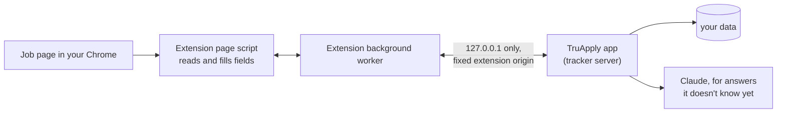

# The Chrome extension

The extension fills job applications in **your own Chrome**. TruApply finds, scores and tailors. The extension fills the form in your tab and attaches the tailored resume. You check it and press Submit, unless you turned on auto-submit (see [safety.md](safety.md#3-auto-submit)).

Why your own Chrome:

- Sites show fewer "prove you're human" puzzles to a normal browser with your history. When one appears, you solve it.
- One browser: no second window to manage.
- It works on any Greenhouse, Lever or Ashby job you find yourself, not only the ones a run found.

What it never does: solve or avoid a CAPTCHA, tick a consent or agreement box, or guess a legal question. Those are left to you.

## Installing it

The tracker's first-run setup has an **Extension** step, and Settings shows the same steps:

1. Open `chrome://extensions` in Chrome.
2. Turn on Developer mode.
3. Click **Load unpacked** and pick the folder the page shows. It's `truapply/extension/`, built from `web/extension/` by `cd web && npm run build`. Users get it ready-built; no Node needed.
4. Keep the TruApply app running while you apply.

The page checks live that the extension is installed: it posts `truapply:hello` to itself, and the extension's small script on `127.0.0.1` (`wake.ts`) answers `truapply:here`. Until it answers, the page says it's waiting for the extension.

## What you see

1. In the tracker, a ready or scored job has **Open in my Chrome**. It opens the application page in a new tab.
2. The extension shows a small TruApply panel on the page: the company, the job and its score.
3. On a ready job's application form, it fills right away. Fields fill in, the tailored resume is attached, and the panel lists what's left for you: a consent box, a question your profile doesn't answer, another file to attach. Those fields get a yellow outline.
4. You check the form and press Submit.
5. When the site shows its confirmation, the job becomes **Applied** in the tracker, with "submitted by you in your Chrome".

On a Greenhouse, Lever or Ashby page the panel also handles jobs that aren't ready:

- **A job TruApply doesn't have:** "This job isn't in TruApply yet" and **Add to TruApply**. It's added, scored and tailored in the background (about a minute), then filled.
- **A job that's found but not tailored, or skipped:** **Tailor my resume for it**.
- **A ready job, but not on the form page:** **Fill this form**.
- **Applied, dismissed or closed:** the panel says so and fills nothing.

**On any other job site**, open the application form and click the TruApply icon in Chrome's toolbar. It adds the job if TruApply doesn't have it (read from the page's job data, or by Claude from the page text), without scoring or tailoring, and fills every field it can right away: your saved answers and profile first, then Claude for the rest. A job that already has a tailored resume gets that one; otherwise your original resume is attached. A form filled this way is never auto-submitted: you check it and press Submit.

## LinkedIn

On a LinkedIn job page you open yourself, the panel can add that one job to TruApply and tailor your resume for it. Nothing more: TruApply never searches LinkedIn and never applies there by itself, and auto-submit never sends a LinkedIn job. LinkedIn's rules ban automation and could restrict your account.

## How it works

The code is in `web/extension/src/`:

- **Page script** (`content.ts`, with `fields.ts` to read the form's fields, `fill.ts` to fill them and `panel.ts` for the panel): reads the form, fills it, and watches for the site's confirmation. A small helper (`network.ts`) runs in the page itself so the filler can wait until the site has finished saving each answer.
- **Background worker** (`background.ts`): the only part that talks to the app. Page scripts never call the app directly. It also runs auto-submit.
- **Tracker helper** (`wake.ts`): runs only on `127.0.0.1`. It answers the installed check and passes on **Send these with auto-submit**.
- **The app** (`truapply/tracker/extension.py`): knows the job, your saved answers, the answers Claude already gave for this job, and your tailored resume. It asks Claude only for fields it has no answer for, with the same rules and checks as everywhere else.

## The link between the extension and the app

- The app listens on `127.0.0.1` only (port 8765 by default).
- The extension has a fixed id, set by the key in its `manifest.json`. The app accepts requests from that one extension origin (`EXTENSION_ORIGIN` in `truapply/tracker/extension.py`) and from its own pages. Requests from any other website or extension are refused. There's no pairing code.
- The page script starts by itself only on Greenhouse, Lever, Ashby and LinkedIn job pages. On any other site it runs only in the tab where you click its icon.
- No data leaves your computer except the application that's sent.

The endpoints are listed in [tracker-api.md](tracker-api.md#chrome-extension).

## Filling

| Field | How |
|---|---|
| Text, email, phone, links | Set the value the way the site expects, so its own code sees the change |
| Dropdowns, including the click-to-open kind | Open it, pick the matching choice |
| Yes/No buttons, radio buttons | Click the right one, like a person would |
| Checkboxes for answers ("Which have you used?") | Tick the right ones |
| Resume | Attached from the app, then waits for the upload to finish |
| Other files | Outlined for you |
| Consent and agreement boxes | **Never ticked.** Outlined for you |
| Legal and eligibility questions with no answer in your profile | **Never guessed.** Outlined for you |
| Passwords | Never read or filled |

Answers come in two steps: first what your profile and saved answers already cover, with no AI call; then Claude for the rest. Claude's answers are kept on the job, so opening it again is instant.

Without auto-submit, it never presses Submit, Next on the last step, or anything that sends.

## Auto-submit

Only while **Auto-submit** is on in Settings. Every minute, right after each send ends, and the moment you press **Send these with auto-submit** (the tracker page signals the extension), the background asks the app for the next job to send (`POST /api/extension/send/next`). The app hands out one job at a time, and during a run only jobs you queued. The extension opens it in a new tab you can see (forms stall in hidden tabs), fills it, and presses Submit only when nothing is left for you, no human check is showing and there's exactly one Submit button. It tells the app first (`/submitting`), so it's never sent twice. It closes the tab once the site confirms. If anything stops it, it tells the app why (`/held`) and leaves the tab filled in for you. The rules are in [safety.md](safety.md#3-auto-submit).

## After Submit

The page script watches for the site's confirmation ("Thank you for applying", "Application submitted"). When it appears and the form is gone, the app marks the job **Applied** and saves what was sent. A confirmation that loads as its own page counts too. Short answers you typed or changed yourself (not long text or files) become saved answers for future forms. If you close the tab, nothing changes. **I submitted it** in the tracker still works for anything sent another way.

## Testing

- Unit tests for the app's side (`tests/unit/test_tracker_extension.py`, `tests/unit/test_autosend.py`): the origin check, finding a page's job, answers, consent left for you, marking applied, auto-submit's rules.
- Live tests (`tests/live/test_extension_live.py`, `pytest -m network`): Playwright starts Chromium with the built extension loaded and fills real Greenhouse, Lever and Ashby forms. Every request that would send the form is blocked, so nothing is ever submitted. `tests/e2e/test_confirmation.py` checks that a thank-you page marks the job applied.

## Not supported

- Applying on LinkedIn, Naukri, Indeed or Wellfound.
- Firefox and Safari.
- The Chrome Web Store. You load the extension from a folder for now.
