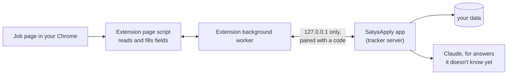

# The Chrome extension (plan)

Status: **planned**, not built yet.

## Goal

Fill job applications in **your own Chrome**, not in a separate browser. SatyaApply still finds, scores and tailors. The extension fills the form in your tab and attaches the tailored resume. You check it and press Submit.

Why:

- Sites show fewer "prove you're human" puzzles to a normal browser with your history. When one appears, you solve it.
- One browser: no second window to manage.
- It works on any Greenhouse, Lever or Ashby job you find yourself, not only the ones a run found.

What stays the same: nothing is ever submitted without you pressing Submit. No CAPTCHA is solved or avoided. Consent boxes and legal questions are left to you.

## What you'll see

1. In the tracker, a job has **Open in my Chrome**. It opens the application page in a new tab.
2. The extension shows a small SatyaApply panel on the page: the job, its score, and **Fill this form**. Opened from the tracker, it fills right away.
3. Fields fill in, the tailored resume is attached, and the panel says what's left for you: "Tick the consent box", "Answer 1 question". Those fields get a yellow outline.
4. You check the form and press Submit.
5. When the site shows its confirmation, the job becomes **Applied** in the tracker. The panel offers **Next job**, which opens the next one waiting for you.

On a job page SatyaApply doesn't know yet, the panel offers **Add and fill**. It adds the job, scores it, and fills it with your resume: tailored (about a minute) or your original (right away), your pick.

## How it works

- **Page script:** reads the form's fields (the same field reader the app uses today, `apply/fields.js`) and fills them.
- **Background worker:** the only part that talks to the app. Page scripts never call the app directly.
- **The app:** knows the job, your saved answers, what the run already filled, and your tailored resume. It asks Claude only for fields it has no answer for, with the same rules and checks as a run.

## The link between the extension and the app

- The app listens on `127.0.0.1` only, as today.
- **Pairing:** Settings in the tracker shows a one-time code. You paste it into the extension once. Both sides keep a token: the app in the OS keychain, the extension in its own storage.
- Every extension request carries the token. Without it, the request is refused. The tracker's existing rules stay: no request from another website gets in.
- The extension runs only on Greenhouse, Lever and Ashby job pages and on `127.0.0.1`. It reads nothing else.
- No data leaves your computer except the application you send.

## Filling

| Field | How |
|---|---|
| Text, email, phone, links | Set the value the way the site expects, so its own code sees the change |
| Dropdowns, including the click-to-open kind | Open it, pick the matching choice |
| Yes/No buttons, radio buttons | Click the right one, like a person would |
| Checkboxes for answers ("Which have you used?") | Tick the right ones |
| Resume and cover letter | Attached from the app, then waits for the upload to finish |
| Consent and agreement boxes | **Never ticked.** Outlined for you |
| Legal and eligibility questions with no answer in your profile | **Never guessed.** Outlined for you |

It fills only when you open a job from the tracker or press **Fill this form**. It never presses Submit, Next on the last step, or anything that sends.

## After Submit

The page script watches for the site's confirmation ("Thank you for applying", "Application submitted"). When it appears and the form is gone, the app marks the job **Applied** with "submitted by you". If you close the tab, nothing changes. **I submitted it** in the tracker still works for anything sent another way.

## Changes in the app

- New API endpoints, token only, listed in [tracker-api.md](tracker-api.md) when built:
  - pair the extension,
  - find the job for a page address,
  - get the answers for a set of fields (saved answers, the run's answers, then Claude for the rest),
  - get the tailored resume file,
  - add a job from a page address,
  - mark a job submitted by you.
- Tracker: **Open in my Chrome** on jobs that wait for you, and an **Extension** section in Settings with install steps and the pairing code.
- The project rule "the app never touches your own Chrome" changes to: it touches it only through the extension you install, only on job pages, only to fill.
- The separate filled-in browser stays as a fallback until the extension has proven itself, then we decide whether to keep it.

## Build steps

Each step ends with checks that must pass.

### 1. The link (half a day)

- Extension skeleton: Manifest V3, TypeScript, built with the same tools as the tracker into `satyaapply/extension/`, so users load a ready folder. No Node needed for users.
- Pairing, the token check, and the job lookup endpoint.
- **Must pass:** a request without the token is refused; the extension finds the job for a tracker job's page.

### 2. Filling (1 day)

- The field reader from `apply/fields.js`, shared, not copied.
- A filler for every field type in the table above, including Ashby's Yes/No buttons and required markers.
- The answers endpoint and the panel with **Fill this form** and the "left for you" list.
- **Must pass:** the test form (`tests/e2e/form.html`) fills completely in Chromium with the extension loaded; consent boxes stay unticked; nothing is submitted.

### 3. Finishing (half a day)

- Confirmation watch, **Applied** in the tracker, **Next job**.
- **Open in my Chrome** in the tracker.
- **Must pass:** submitting the test form marks the job applied; closing the tab changes nothing.

### 4. Any job page (half a day)

- **Add and fill** for pages the app doesn't know, using the same intake as **Add a job link**.
- **Must pass:** a Greenhouse, Lever or Ashby link the app has never seen gets added, scored and filled.

### 5. Live forms and docs (half a day)

- Fill 10 real live forms per site in practice mode with the extension loaded: every required field filled, consent boxes left, nothing submitted.
- Docs: this file becomes the how-it-works page; [safety.md](safety.md), [tracker-api.md](tracker-api.md) and the project rules updated.

About **3 days** in total.

## Reading LinkedIn on its own

Off until you tick **Settings → Automation → Read new LinkedIn jobs on its own**. While Chrome is open, every 4 hours the background worker asks the app for a plan (`/api/extension/linkedin-plan`), then opens each search in a background tab, one at a time, half a minute apart. The page reads its job cards like **Add N jobs** does, saves them, and tells the worker it's done; the worker closes the tab. A page with no job cards (a sign-in or check page) stops the round. Each round's outcome is kept in `chrome.storage.local` under `linkedinLastRound`. It never applies on LinkedIn; filling Easy Apply comes later, built against saved pages.

## Testing

- Unit tests for the token check and every new endpoint.
- Browser tests: Playwright starts Chromium with the extension loaded and fills `tests/e2e/form.html` and its variants (slow upload, click-to-open dropdowns, Yes/No buttons, consent box).
- Live tests (`pytest -m network`): real forms in practice mode, never submitted.

## Decisions needed

1. When opened from the tracker, fill right away, or wait for **Fill this form**? Suggested: right away.
2. On a job the app doesn't know: tailor first (about a minute) or use your original resume? Suggested: ask each time.
3. Keep the separate filled-in browser after the extension works? Suggested: keep it for a few weeks, then decide.

## Not in this plan

- LinkedIn, Naukri, Indeed, Wellfound.
- Firefox and Safari.
- The Chrome Web Store. You load the extension from a folder for now.
