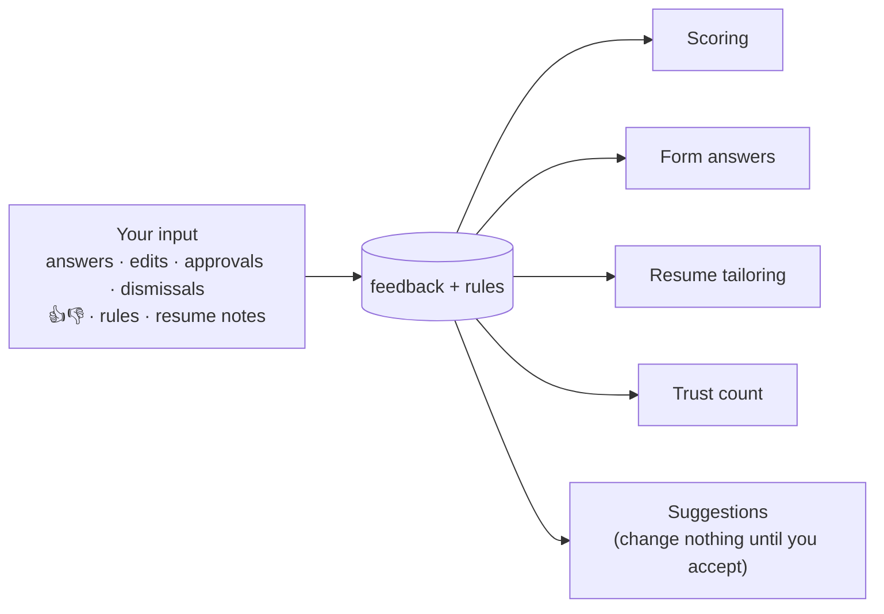

# Outcomes and learning

Sending applications is only half the job. This part learns **what you want** from what you do, and uses it to send better ones. It never reads your email.



## 1. Learning from you

Every action you take on the tracker page teaches it something. It starts with your very first action; there's no warm-up.

| What you do | What it learns | Where it's used |
|---|---|---|
| Answer a question it couldn't (`needs_input`) | Your answer | Every future form with that question. No AI call needed. The job goes back to `scored` and is filled on the next run. |
| Edit the filled-in answers before approving | Your version replaces the AI's | The same. The AI's answer to that question is never reused. An edit also resets the trust count. |
| Approve with no edits | This was a good match, and the answers were right | Scoring examples; adds one to the trust count. The job is sent on the next run. |
| Dismiss, with a reason: *wrong role · too senior · too junior · location · salary · company · other* | What you don't want | The job is never applied to. Scoring examples, and suggestions like "Add 'staff' to skip titles?" |
| 👍 / 👎 on any job | Good or bad match | Scoring examples. A 👎 resets the trust count, and 👎 on auto-submitted jobs can turn auto-submit off (see [safety.md](safety.md#3-trust-before-auto-submit)). |
| Write a tailoring note on a job page ("don't change my headline", "keep my project order") | How you like your resume tailored | Added to every future tailoring prompt |
| Revert a tailored resume to the original | That tailoring went too far | Suggests a tailoring note for you to accept |
| Press **I submitted it** or **Dismiss** on a **Ready for you to apply** job | That you applied yourself, or didn't want it | The job becomes `applied` or `dismissed` |
| Type a rule in **Tell TruApply**: "no staffing agencies", "prefer product companies", "Pune is fine, Mumbai is not" | Your preferences, in your words | Every scoring call, as the candidate's preferences |

Every tracker action is saved as a row in the `feedback` table. Rules, tailoring notes and suggestions are saved in the `rules` table (see [architecture.md](architecture.md#data-model)).

**Rules for learning from you**

- **Everything learned is visible.** The **What it learned** page (`/learned`) lists every rule, tailoring note, saved answer (from you or from the AI) and pending suggestion in plain words. Each can be edited or deleted.
- **Suggestions change nothing until you accept them.** For example, after 3 dismissals as "too senior", a word their titles share is offered as a new skip word: "Add 'staff' to skip titles?" The title filter only uses it once you accept. The same goes for a higher minimum score or a tailoring note.
- **Rules are preferences, not facts.** A **Tell TruApply** rule is passed to every scoring call as what you want. It can make a job score lower or higher, but it never adds anything to your resume or your answers.
- **Your input wins.** An answer or rule from you always beats one the AI came up with.
- **It stays inside the safety rules.** Nothing learned can override [safety.md](safety.md), add a fact to your resume, or raise a daily limit. A rule like "say I know Kubernetes" is refused: facts come only from your resume and your "anything else" note.
- **It's measured.** The tracker shows your edits per reviewed application. If learning works, that number falls week by week.

## 2. Daily summary

Once a day, after the first run past 8 pm (`settings.summary_hour`):

- a **notification** (macOS `osascript`, Windows PowerShell, Linux `notify-send`)
- a file, `~/.truapply/summaries/<date>.md`
- a box at the top of the tracker page

```
TruApply · Tue 27 Oct
Applied 14 (career pages 9 · LinkedIn 5) · limit 20
Needs you: 2 questions · 1 to finish yourself (human check) → open the tracker
Problems: Indeed paused (logged out) → run `truapply login`
```

**Instant alerts** (not held until the summary): a site paused because of a block or logout; the Claude usage limit hit two runs in a row.
