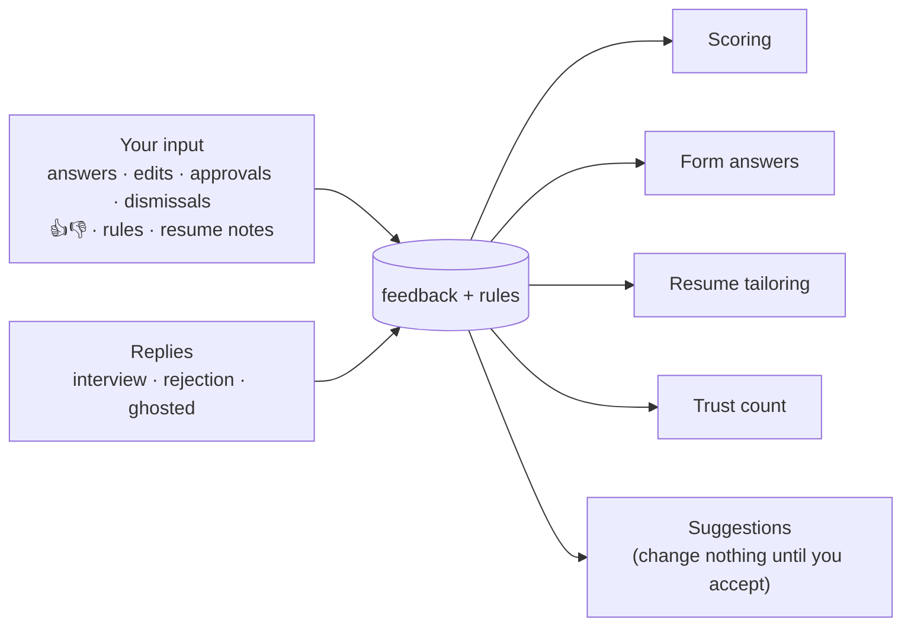
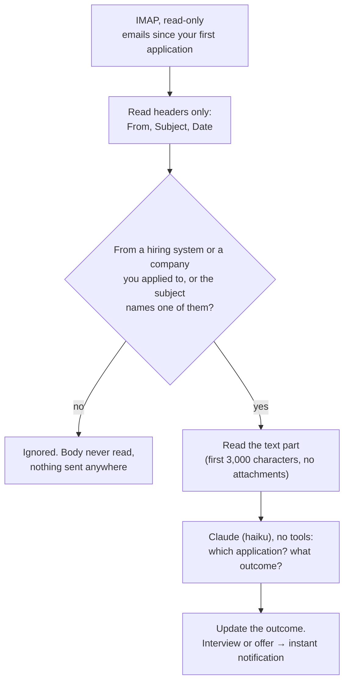

# Outcomes and learning

Sending applications is only half the job. This part learns **what you want** from what you do, finds out **what happened** to each application, and uses both to send better ones.



## 1. Learning from you

Every action you take on the tracker page teaches it something. It starts with your very first action; there's no warm-up.

| What you do | What it learns | Where it's used |
|---|---|---|
| Answer a question it couldn't (`needs_input`) | Your answer | Every future form with that question. No AI call needed. The job goes back to `scored` and is filled on the next run. |
| Edit the filled-in answers before approving | Your version replaces the AI's | The same. The AI's answer to that question is never reused. An edit also resets the trust count. |
| Approve with no edits | This was a good match, and the answers were right | Scoring examples; adds one to the trust count. The job is sent on the next run. |
| Dismiss, with a reason: *wrong role · too senior · too junior · location · salary · company · other* | What you don't want | The job is never applied to. Scoring examples, and suggestions like "Add 'staff' to skip titles?" |
| 👍 / 👎 on any job | Good or bad match | Scoring examples. A 👎 resets the trust count, and 👎 on auto-submitted jobs can turn auto-submit off (see [safety.md](safety.md#3-trust-before-auto-submit)). |
| Write a tailoring note on a job page ("don't change my headline", "keep my project order") | How you like your resume tailored | Added to every future tailoring prompt |
| Revert a tailored resume to the original | That tailoring went too far | Suggests a tailoring note for you to accept |
| Press **I submitted it** or **Skip it** on a **Finish these** job | That you applied yourself, or didn't want it | The job becomes `applied` or `dismissed` |
| Fix a reply's job or outcome | How to read your emails | Examples for email classification |
| Type a rule in **Tell SatyaApply**: "no staffing agencies", "prefer product companies", "Pune is fine, Mumbai is not" | Your preferences, in your words | Every scoring call, as the candidate's preferences |

Every tracker action is saved as a row in the `feedback` table. Rules, tailoring notes and suggestions are saved in the `rules` table (see [architecture.md](architecture.md#data-model)).

**Rules for learning from you**

- **Everything learned is visible.** The **What it learned** page (`/learned`) lists every rule, tailoring note, saved answer (from you or from the AI) and pending suggestion in plain words. Each can be edited or deleted.
- **Suggestions change nothing until you accept them.** For example, after 3 dismissals as "too senior", a word their titles share is offered as a new skip word: "Add 'staff' to skip titles?" The title filter only uses it once you accept. The same goes for a higher minimum score or a tailoring note.
- **Rules are preferences, not facts.** A **Tell SatyaApply** rule is passed to every scoring call as what you want. It can make a job score lower or higher, but it never adds anything to your resume or your answers.
- **Your input wins.** An answer or rule from you always beats one the AI came up with.
- **It stays inside the safety rules.** Nothing learned can override [safety.md](safety.md), add a fact to your resume, or raise a daily limit. A rule like "say I know Kubernetes" is refused: facts come only from your resume and your "anything else" note.
- **It's measured.** The tracker shows your edits per reviewed application. If learning works, that number falls week by week.

## 2. Reply tracking

Reads your inbox **read-only** and matches job emails to the applications they're about.



### Setup

`satyaapply email` (also offered during setup):

1. Your email address (pre-filled from the resume). The server is detected from the address.
2. Create an **app password**: a separate password just for this tool, which you can revoke at any time.
3. Paste it in. The input is hidden, and it's stored in the macOS Keychain (Linux: `secret-tool`, otherwise a file only you can read).
4. A test connection checks that it works, without changing anything.

| Provider | Server | App password |
|---|---|---|
| Gmail | `imap.gmail.com` | Google Account → Security → 2-Step Verification on → App passwords |
| iCloud | `imap.mail.me.com` | appleid.apple.com → Sign-In and Security → App-Specific Passwords |
| Yahoo | `imap.mail.yahoo.com` | Account security → Generate app password |
| Fastmail | `imap.fastmail.com` | Settings → Privacy & Security → App passwords |
| Zoho | `imap.zoho.com` | Security → App passwords |
| Outlook.com | — | Not supported in v1 |

### Rules

- **Read-only.** The mailbox is opened with `EXAMINE`, and messages are fetched with `BODY.PEEK`. Nothing is marked read, moved or deleted.
- **Only job emails are read past the headers**: emails from known hiring senders (Greenhouse, Lever, Ashby, Workday, LinkedIn job alerts, Naukri, Indeed, Wellfound …), from the domain of a company you applied to, or with a subject naming one of those companies.
- **Each email is handled once** (`emails.msg_id`).
- **You can fix a wrong match** on the tracker's job page.

### Outcomes

| Outcome | Example email | Effect |
|---|---|---|
| `confirmed` | "Thanks for applying to Northwind" | Marks a submission confirmed (also fixes `unconfirmed`) |
| `rejected` | "We've decided to move forward with other candidates" | Negative signal |
| `assessment` | "Please complete this coding challenge" | Positive signal, instant notification |
| `interview` | "We'd like to schedule a call" | Positive signal, instant notification |
| `offer` | "We're pleased to offer you…" | Positive signal, instant notification |
| `ghosted` | (no reply for 21 days) | Weak negative signal |

## 3. Learning from results

Starts once there are **≥ 10 outcomes**. It never touches the safety rules, the limits, or your facts. Its examples are mixed with the ones from your own input (section 1).

| Signal | Weight |
|---|---|
| Interview, assessment, offer | Positive |
| Your 👍 on a job | Positive (for matching) |
| Rejected | Negative. A rejection within 3 days usually means an automatic filter, so it's recorded separately. |
| Ghosted | Weak negative |
| Your 👎 "bad match" | Strong negative (for matching) |

What it changes:

1. **Scoring examples.** The scoring prompt includes up to 5 recent jobs that worked and 5 that didn't (title, company type, the reason they scored well). The AI learns what "a good match for you" really means.
2. **Threshold suggestions.** If a score band, e.g. 60–69, has 15+ applications and no positive outcomes, the daily summary suggests raising the minimum score. One click on the tracker applies it. **It's never changed automatically.**
3. **Insights page.** Reply rate by site, by score band, by tailored vs original resume, and by how old the job was when you applied. These are plain numbers you can act on.

## 4. Daily summary

Once a day, after the first run past 8 pm (`settings.summary_hour`):

- a **notification** (macOS `osascript`, Linux `notify-send`)
- a file, `~/.satyaapply/summaries/<date>.md`
- a box at the top of the tracker page

```
SatyaApply · Tue 27 Oct
Applied 14 (career pages 9 · LinkedIn 5) · limit 20
Replies: 1 interview (Northwind) · 2 rejections
Needs you: 2 questions · 1 to finish yourself (human check) → open the tracker
Problems: Indeed paused (logged out) → run `satyaapply login`
```

**Instant alerts** (not held until the summary): an interview, assessment or offer email; a site paused because of a block or logout; the Claude usage limit hit two runs in a row.
