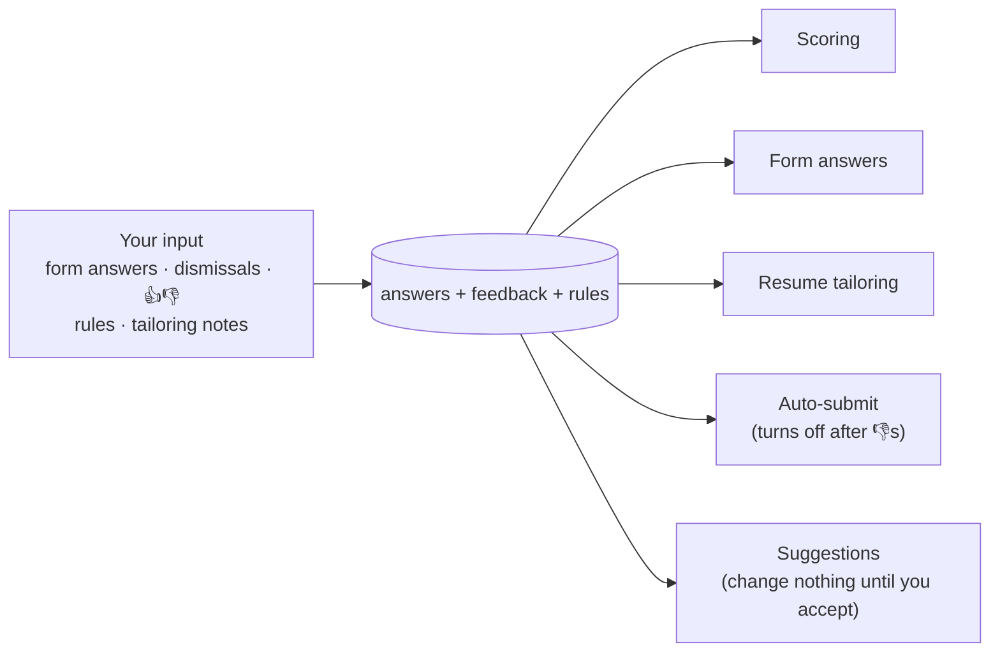

# Outcomes and learning

Sending applications is only half the job. This part learns **what you want** from what you do, and uses it to prepare better ones. It never reads your email.



## 1. Learning from you

Every action you take teaches it something. It starts with your very first action; there's no warm-up.

| What you do | What it learns | Where it's used |
|---|---|---|
| Type or change an answer on a form the extension filled, then submit | Your answer | Every future form with that question, with no AI call. Short answers only, not long text or files. |
| Edit or delete a saved answer on **What it learned** | Your version | The same. An answer from you is never overwritten by the AI. |
| Let Claude answer a question | Claude's answer, when it can be reused | Saved as an AI answer for future forms, until you change it. Its answers for a job are also kept on that job, so opening it again is instant. |
| Dismiss, with a reason: *wrong role · too senior · too junior · location · salary · company · job is closed · other* | What you don't want | The job is never prepared again ("job is closed" marks it `closed`). After 3 "too senior" dismissals, a word their titles share is suggested as a skip word. |
| 👍 / 👎 on any job | Good or bad match | Saved on the job. A 👎 on auto-submitted jobs can turn auto-submit off (see [safety.md](safety.md#3-auto-submit)). |
| Write a tailoring note ("don't change my headline", "keep my project order") | How you like your resume tailored | Added to every future tailoring prompt |
| Revert a tailored resume to the original | That tailoring went too far | The job gets your original resume. Saved as feedback. |
| Press **I submitted it** or **Dismiss** on a ready job | That you applied yourself, or didn't want it | The job becomes `applied` or `dismissed` |
| Type a rule in **Tell TruApply**: "no staffing agencies", "prefer product companies", "Pune is fine, Mumbai is not" | Your preferences, in your words | Every scoring call, as the candidate's preferences |

Tracker actions are saved as rows in the `feedback` table. Rules, tailoring notes and suggestions are in the `rules` table, saved answers in `answers`, and Claude's answers for one job in `job_answers` (see [architecture.md](architecture.md#data-model)).

**Rules for learning from you**

- **Everything learned is visible.** The **What it learned** page (`/learned`) lists every rule, tailoring note, saved answer (from you or from the AI) and pending suggestion in plain words. Each can be edited or deleted.
- **Suggestions change nothing until you accept them.** After 3 dismissals as "too senior", a word their titles share is offered as a new skip word: "Add 'staff' to skip titles?" The title filter only uses it once you accept.
- **Rules are preferences, not facts.** A **Tell TruApply** rule is passed only to scoring, as what you want. It can make a job score lower or higher, but it never reaches your resume or your form answers.
- **Your input wins.** An answer from you always beats one the AI came up with.
- **It stays inside the safety rules.** Nothing learned can override [safety.md](safety.md), or raise a daily limit. Rules and notes aren't checked when you add them, but a tailoring note that leads to a new claim on your resume is caught by the resume checks, and the original resume is used.

## 2. Daily summary

Once a day, after the first run at or after 8 pm (`settings.summary_hour`):

- a **notification** (macOS `osascript`, Windows PowerShell, Linux `notify-send`), titled "TruApply today", such as "3 applied · 4 ready for you to apply", or "Nothing new today."
- a file, `~/.truapply/summaries/<date>.md`:

```
# TruApply · 27 Oct 2026

- Applied today: 3
- Prepared today: 5
- Ready for you to apply: 4
- Claude calls today: 61 of 300

Open them from your tracker; the extension fills them in your Chrome.
```

There are no other alerts. Problems in a run show in its log on the tracker's Run page.
