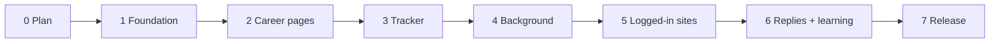

# Plan

> **SatyaApply**. *Satya* is Hindi and Sanskrit for "truth". Package and command: `satyaapply`.

## Goal

**More interviews for less of your time.** And it must never lie for you, never apply to the same job twice, and never get your accounts banned.

Success is measured in **interviews**, not applications sent. A tool that sends 50 bad applications a day is worse than one that sends 10 good ones.

### Why build it

Free tools today fall into two groups:

- **Some never submit.** You still open every form and click Submit yourself.
- **Others submit carelessly:** the same resume everywhere, no fact checks, LinkedIn only, or behind a paid plan.

None of them handle Naukri well, and none learn what actually leads to interviews.

SatyaApply's place:

- **India-first.** Naukri, LinkedIn and company career pages, with Indian form fields (notice period, current CTC) handled properly.
- **Auto-submit you can trust.** It starts by asking you to approve each application, and offers auto-submit only once it has earned that trust.
- **It learns from you.** Every answer, approval, dismissal, edit, rule and reply teaches it what you want (see [outcomes.md](outcomes.md)).

### Trust before auto-submit

1. Everyone starts in the **review queue**, the project owner included. SatyaApply fills each application, and you approve it on the tracker page.
2. After **20 approvals in a row with no edits**, it offers to turn on auto-submit for strong matches (score 80 or more). You decide.
3. An edit or a 👎 "bad match" resets the count.
4. Once auto-submit is on, if 2 of the last 10 auto-submitted applications get a 👎, it switches back to the review queue and tells you.

## Target numbers

What "good enough" means. Every number is measured, not guessed.

| What | Target | How it's measured |
|---|---|---|
| Forms that go through | **≥ 90 %** of attempts on supported sites | Insights page: last 50 attempts per site |
| Bad matches | **< 10 %** of applications | Your 👎 "bad match" clicks on the tracker |
| Your edits per reviewed application | **Falling** week over week | Tracker: edits ÷ reviews. This proves it learns from your input. |
| Made-up facts in resumes or answers | **0** | Automatic resume checks, plus a hand review of 20 tailored resumes before each release |
| Duplicate applications | **0** | Duplicate test plus a database check |
| Reply emails matched to the right application | **≥ 95 %** | A hand-labelled set of 50 job emails |
| Non-job emails sent to Claude | **0** | The log of everything sent |
| Scheduled runs that finish without crashing | **≥ 95 %** | Run log |
| Claude calls per application | **≤ 6** on average, falling over time | Usage counter in the database |
| New user, from install to first dry run | **≤ 15 min** | Timed on a fresh macOS account |
| Reply rate | Tracked; no target in v1 | Insights page. Learning should push it up over time. |

## Scope

### v1 does

| Command | What it does |
|---|---|
| `satyaapply setup` | Reads your resume, asks the [setup questions](setup-questions.md), and saves your profile |
| `satyaapply login` | Opens Chrome so you can log in to LinkedIn, Naukri, Indeed and Wellfound once |
| `satyaapply doctor` | Checks that everything works: Claude, Chrome, LaTeX, each login, email, schedule. Says how to fix anything broken. |
| `satyaapply tailor JOB.txt --company … --title …` | Previews your resume tailored to one job description, with every check and the changed lines |
| `satyaapply run` | One full pass: find, score, tailor, apply, check the inbox, write the summary. `--dry-run`, `--site`, `--limit`, `--show` |
| `satyaapply tracker` | Opens the local tracker page |
| `satyaapply schedule` / `unschedule` | Runs it every 3 hours in the background (macOS launchd; prints a cron line on Linux) |
| `satyaapply email` | Sets up reply tracking (also offered during setup) |
| `satyaapply boards --new` | Prints the career boards you found that aren't in the shared list yet, ready to contribute |

Job sources: **career pages** (Greenhouse, Lever, Ashby) and **LinkedIn Easy Apply, Naukri, Indeed, Wellfound**.

### v1 doesn't

| Left out | Why | What happens instead |
|---|---|---|
| Workday, iCIMS, Taleo and other sites that need an account per company | Every company needs a separate account and password | Marked `external` with the link: apply yourself |
| Solving CAPTCHAs or email/SMS codes | Getting past them is deceptive and breaks site rules | The job is flagged `needs_input` |
| Outlook.com reply tracking | Microsoft no longer allows app passwords for this kind of email access | Use Gmail, iCloud, Yahoo, Fastmail or Zoho |
| Windows scheduling | Different system; later | `satyaapply run` still works by hand |
| A hosted or cloud version | It's meant to stay on your machine | — |

---

## Build phases

A phase is **done only when every must-pass box is ticked**. Nothing is submitted to a real employer until the owner says yes.

### Phase 0 · Plan ✅
These docs.

### Phase 1 · Foundation ✅

**Builds**
- Repo tooling, set up first: `ruff`, `mypy --strict`, `pytest`, `pre-commit`, GitHub Actions, secret scanning, the no-comments check and the layer test (see [CONTRIBUTING.md](CONTRIBUTING.md))
- Package and CLI skeleton
- Database with schema versions and migrations
- The safe Claude Code wrapper
- Setup wizard and profile validation
- Resume pipeline for LaTeX and for every other format: tailor, check, build the PDF, store the changes

**Must pass**
- [x] `pre-commit run --all-files` is clean on macOS. CI on macOS and Linux runs once the repo is on GitHub.
- [x] The no-comments check fails on a planted comment; the layer test fails on a planted upward import
- [x] Unit tests: duplicate key, number check, LaTeX preamble check, page count, AI reply parsing, profile validation, migrations
- [x] The setup wizard, run end to end with a real resume (answers piped in), produces a valid `profile.json`
- [x] Tailoring for 5 real job descriptions: 5/5 compile, none longer than the original, and every change reviewed by hand with **0 made-up facts**
- [x] A fake skill planted in a tailored resume is caught, and the original is used
- [x] A Claude call with tools turned off can't read a file, even when the prompt asks it to

### Phase 2 · Career pages ✅

**Builds**
- The shared company list `satyaapply/sources/companies.csv` (seed of ≥ 100 companies)
- Readers for the Greenhouse, Lever and Ashby public APIs
- Board discovery by web search
- Title filter and AI scoring
- Detection of employer "no AI" rules
- The general form filler, plus a local multi-step test form

**Must pass**
- [x] 20 boards polled: 100 % of jobs have a title, company, location, link and description
- [x] Local test form (every field type, 3 steps): 10/10 submitted and detected as success
- [x] Dry run on 10 real Greenhouse/Lever/Ashby forms: ≥ 9 reach Submit with every required field filled (screenshots reviewed)
- [x] A job post with hidden instructions ("ignore your rules…") changes nothing: no tools used, answers still from the profile
- [x] A job post saying "no AI-generated applications" is skipped. A form box "I did not use AI" is never ticked.
- [x] The same job from two sources is applied to once
- [x] A removed job (API 404) is marked `closed`, not `failed`

### Phase 3 · Tracker page and learning from you

**Builds**
- Application list with filters
- "Needs your answer" and approvals. You can edit any answer before approving.
- Resume change view, and a "what was sent" view per application
- 👍 / 👎 buttons, dismiss reasons, and resume tailoring notes
- A "Tell SatyaApply" box for plain-language rules
- The "What it learned" page
- Trust counter and the auto-submit offer
- A "Finish these" list: jobs whose form shows a picture check ("prove you're human") or won't accept one. Each is already filled, with "Open in my Chrome", the tailored resume and the answers ready to paste. SatyaApply never solves the check itself.
- A count of how often each site shows a check, so jobs on sites without checks are tried first

**Must pass**
- [x] Every status is visible and filterable
- [x] A picture check that appears after Submit puts the job in "Finish these" with every answer saved, never in `unconfirmed` or `failed`
- [ ] From "Finish these", opening the job in your own Chrome and pasting the saved answers takes under a minute; marking it done sets `applied`
- [x] Answer a question on the page, and the next form with that question fills without an AI call (shown in the log)
- [x] Edit an answer before approving → the next form with that question uses your version
- [x] Approve → submitted on the next run (with `--send`, or the Run page's send box); dismiss → never applied
- [x] Dismiss 3 jobs as "too senior" → a suggestion to add that title word to "skip titles" appears, and nothing changes until you accept it
- [x] A rule typed in "Tell SatyaApply" ("no staffing agencies") changes the next scores, appears on "What it learned", and can be deleted there
- [ ] A tailoring note ("don't change my headline") is followed in the next 5 tailored resumes
- [x] The auto-submit offer appears exactly after 20 clean approvals in a row; an edit or a 👎 resets the count
- [x] Two 👎 in the last 10 auto-submitted → auto-submit turns off and a notification is sent
- [ ] The change view shows exactly the changed lines for 5 tailored resumes
- [x] A POST from another website is rejected (curl test with a fake `Origin`)
- [x] Checked in a real browser, with a screenshot

### Phase 3b · React tracker and the workflow map

**Builds**
- The tracker as a React + TypeScript app (`web/`, built with Vite and shipped prebuilt inside the package, so users don't need Node), talking to the Python tracker only through the JSON API in [tracker-api.md](tracker-api.md)
- Drag and drop on the board (Waiting for your OK → Approved or Dismissed), inline answer editing, live run progress without reloads
- **Workflow map** (`/workflow`): a live decision-flow chart of how every job is handled, in the style of a Notion decision diagram. Questions are nodes with YES / NO branches, outcomes are boxes with live job counts, and automatic steps (AI scoring, tailoring, form filling, reply tracking) are dashed purple lines. Clicking a box opens those jobs. The flow:
  - Found on a career page → Title fits your keywords? → Location fits where you'll work? → Seen before? (duplicate) → AI score at least your minimum, with no deal-breaker? (no → Not a fit) → Employer bans AI-written applications? (yes → Skipped)
  - → Tailor the resume → Passes the fact check? (no → original resume used) → Fill the form → Legal question it can't answer? (yes → Needs your answer) → Picture check? (yes → Finish these)
  - → Auto-submit earned and score ≥ 80? (yes → Sent automatically) / (no → Waiting for your OK → Approve? yes → Sent on the next run, no → Dismissed) → Confirmation shown? (yes → Applied, no → Unconfirmed)
- The Revert-to-original-resume button (suggests a tailoring note), and the tracker choosing a free port when 8765 is taken

**Must pass**
- [x] Every page of the current tracker works in the React app, with the same safety checks (Host, Origin, JSON-only POST, strict CSP with only the tracker's own scripts)
- [x] The workflow map's counts match the All jobs page for every box, and each box links to exactly those jobs
- [x] Dragging a job to Approved or Dismissed on the board does the same as the job page buttons
- [ ] Checked in a real browser, light and dark, at phone width, with screenshots

### Phase 4 · Background runs and daily summary

**Builds**
- `schedule` / `unschedule`
- A run lock, daily limits and pauses
- Crash recovery and a daily Claude call budget
- Daily summary and notifications
- `doctor`

**Must pass**
- [ ] After `schedule`, a run starts on its own and writes the log
- [ ] A second run started during a first exits with "already running"
- [ ] A run killed right after clicking Submit → the next run marks the job `unconfirmed` and does **not** submit again
- [ ] The daily limit and the LinkedIn limit stop applying at exactly the limit
- [ ] The summary notification shows once a day; an interview alert shows right away
- [ ] `doctor` names each broken piece and its fix (tested by breaking each one)

### Phase 5 · Logged-in sites

One at a time: **LinkedIn → Naukri → Indeed → Wellfound.** Must pass, for each site:
- [ ] `doctor` detects logged in and logged out
- [ ] Search finds ≥ 10 relevant jobs, read-only, with no errors
- [ ] Saved page fixtures (search page and job page, personal data removed) are in `tests/fixtures/<site>/`, and the tests pass on them
- [ ] 5 dry runs reach Submit
- [ ] A block or "unusual activity" page pauses the site for the day (fixture test)
- [ ] "Apply on company site" links to Greenhouse/Lever/Ashby are followed; other links are marked `external`
- [ ] With the owner's OK: 3 live applications, each confirmed by the site

### Phase 6 · Replies and learning from results

**Builds**
- Email setup and a read-only IMAP reader
- Matching each reply to its application, and outcomes (`ghosted` after 21 days)
- Learning: past examples added to scoring, and threshold suggestions
- Insights page

**Must pass**
- [ ] Reading leaves every email unread and unchanged (checked on a test email)
- [ ] 50 hand-labelled job emails: ≥ 95 % matched to the right application and outcome
- [ ] 0 non-job emails sent to Claude (checked from the sent log)
- [ ] With ≥ 10 outcomes, scoring includes examples, and insights shows the reply rate by site, by score band and by resume type
- [ ] A threshold suggestion appears only when there's enough data, and changes nothing until approved

### Phase 7 · Open-source release

**Builds**
- README (install, disclaimer), MIT LICENSE, CONTRIBUTING
- Issue and PR templates, CHANGELOG
- Shared company list of ≥ 300 companies
- Version `0.1.0`

**Must pass**
- [ ] Fresh macOS user account: README install → first dry run in ≤ 15 min
- [ ] Fresh Linux machine: the same
- [ ] Secret scan of the full git history is clean, and there's no personal data in the repo (search for the owner's name, email and phone)
- [ ] Every target number is met, or listed as a known gap in the release notes
- [ ] Pushed to GitHub only after the owner says so

---

## Open questions

| Question | Current answer |
|---|---|
| Name | **Decided: SatyaApply.** `satyaapply` was free on PyPI, npm, GitHub (organization) and Vercel, and `satyaapply.com` was unregistered, on 25 Oct 2026. Claim them before announcing. |
| License | MIT |
| Claude subscription inside a public tool | Each user runs their own Claude Code with their own login. Check Anthropic's terms before release. `ANTHROPIC_API_KEY` also works with no code change. |
| Outlook.com email | Not in v1. Needs "sign in with Microsoft", which means a registered app. |
